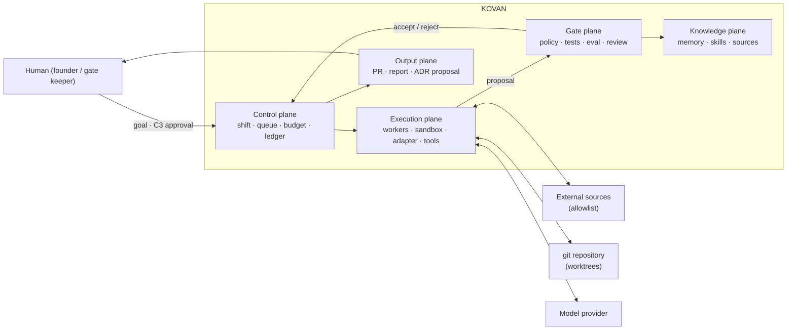
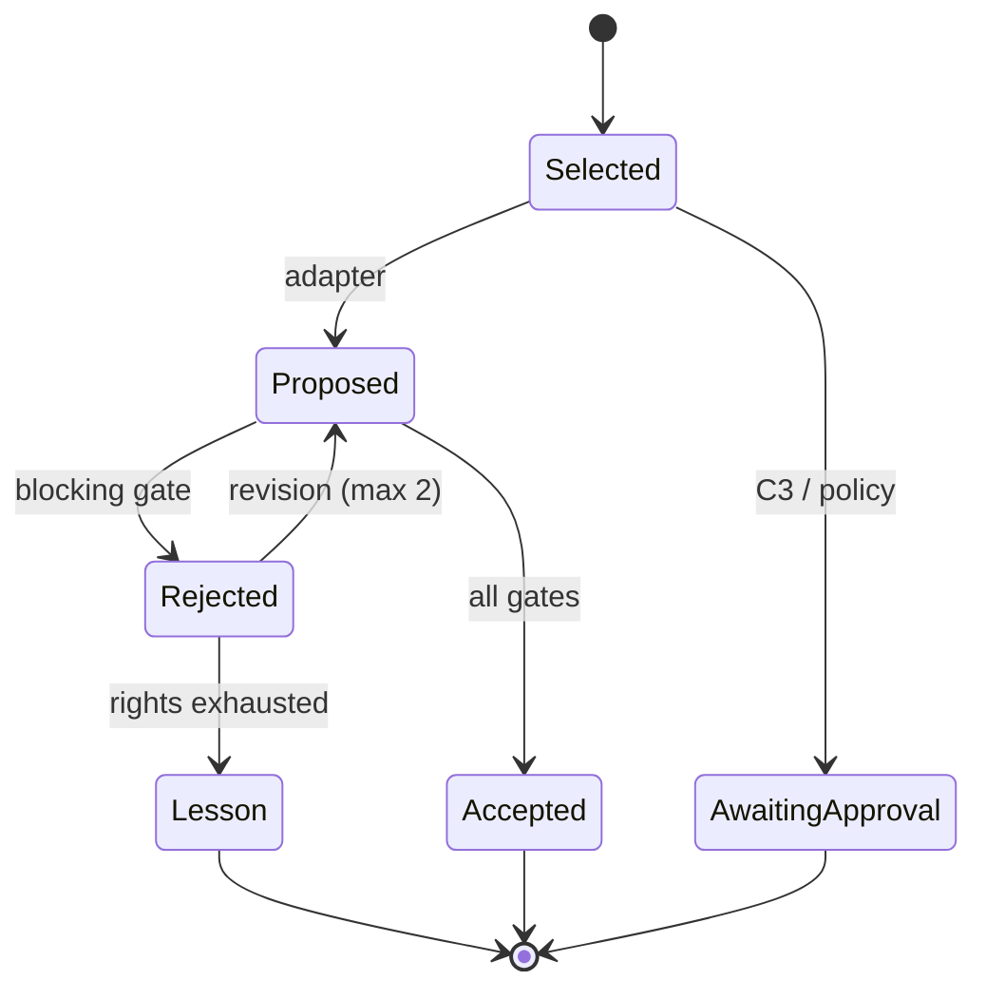

# KOVAN — Architecture

> This document describes **what is being built**; why it was decided this way
> is recorded in [`ADR.md`](ADR.md). The code's current state lives under
> `loop/` and covers only the skeleton of Ring 1.

---

## 1. Design constraints

The architecture took shape under the following five constraints. All of them
are deliberate; none is "just for now".

| # | Constraint | Consequence |
|---|---|---|
| K1 | **Git is the single source of truth** | State files, spec, skills, reports: all in the repo, versioned, diffable |
| K2 | **The model must be swappable** | Every model call sits behind an `Adapter`; no logic is embedded in a provider |
| K3 | **Fail-closed** | If a decision cannot be made, it stops rather than continues (same principle as Airlock) |
| K4 | **Interruption is normal** | Every turn is restartable; side effects are idempotent |
| K5 | **Start with one repo** | Multi-repo orchestration does not arrive before it is validated in a single repo |

---

## 2. System context



---

## 3. Components

| Component | Plane | Responsibility | Input → Output | Today |
|---|---|---|---|---|
| **Shift** | control | Turn loop, task selection, stopping rules | goal+backlog → decisions | `runner.py` (exists) |
| **Queue** | control | Priority, dependency, review budget | issue list → ordered tasks | YAML (exists, simple) |
| **Budget** | control | Token/USD accounting, tier dropping | usage → warn/stop | Counter (exists) |
| **Ledger** | control | Append-only decision record, hash chain | decision → record | `Ledger` (exists) |
| **Worker** | execution | Executes one role's contract | task → candidate change | None (adapter empty) |
| **Sandbox** | execution | Container + worktree + network allowlist | task → isolated environment | Spec exists, no code |
| **Adapter** | execution | Model call, tool execution | prompt+tools → output | Interface exists |
| **Tools** | execution | File, shell, search, MCP | call → result | Via Airlock (planned) |
| **Policy** | gate | Forbidden path/permission check | diff/call → allow/ask/block | Rule (exists), Airlock (separate repo) |
| **Gate engine** | gate | Ordered, fail-fast evaluation | candidate → gate results | `evaluate()` (exists) |
| **Eval** | gate | Regression set, threshold, canary | release → score | None |
| **Review** | gate | Reasoned approval in an independent context | patch → reject/approve | None |
| **Memory** | knowledge | Notes, lessons, index, decay | record → searchable knowledge | JSONL (exists) |
| **Skill** | knowledge | Procedure library (SKILL.md) | lesson → skill | Candidate record (exists) |
| **Report** | output | One-page morning report | shift → md | `demo.py` (exists) |

---

## 4. Task life cycle



State transitions are written to the ledger. A task cannot be in two states
at once: selection is single-threaded (the single-writer rule, see §8).

---

## 5. Repository layout (target)

```
kovan/
  anayasa/            # immutable: articles 1-10, gate definitions
  loop/               # runner, goal, gates, roster (today it lives here)
    goal.yaml
    gates.yaml
    agents.yaml
    constitution.md
    runner.py
    ledger.jsonl      # generated
    lessons.jsonl
    skills.proposed.jsonl
  kadro/              # role prompts + SKILL.md files
    incelemeci/SKILL.md
    damitici/SKILL.md
  skills/             # active skills (measured)
  specs/              # per-task spec + acceptance criteria
  bellek/             # index (sqlite) + notes (md)
  arastirma/          # sourced notes
  olcum/              # regression sets, eval runs
  rapor/              # sabah-YYYY-MM-DD.md
  oneri/              # ADR drafts
  arac/               # CLI
```

**Rule:** `anayasa/` and `loop/goal.yaml` are write-forbidden (the policy
gate). `skills/` is written only by the distiller, and only with a
measurement record.

---

## 6. Technical mapping of the four rings

| Ring | Trigger | State | Output | Failure behavior |
|---|---|---|---|---|
| R1 Task | work in the queue | `state.json` + ledger | patch/PR | revision → lesson → next |
| R2 Shift | cron 23:00 | shift file | report + skill candidate | partial report if the budget runs out |
| R3 Release | skill/release approval | release record + eval | canary | below threshold → automatic rollback |
| R4 Structure | weekly | ledger + metrics | ADR draft | no measurement → proposal rejected |

R2 and R4 are rings **without write authority**: they only produce proposals.
This is the architectural counterpart of the "no production at night" rule.

---

## 7. Data model (minimum)

```jsonc
// ledger record
{"seq": 12, "ts": 1792..., "prev": "sha256...", "payload": {
  "type": "decision", "task": "K-102", "kind": "accepted",
  "reason": "tüm kapılar geçti",
  "gates": [{"gate":"tests","ok":true,"blocking":true,"detail":"geçti"}]
}, "hash": "sha256..."}

// lesson
{"task":"K-102","gate":"tests","detail":"başarısız","fingerprint":"a1b2c3d4e5f6","seen":2}

// skill candidate
{"kind":"skill_candidate","fingerprint":"a1b2c3d4e5f6","gate":"tests",
 "symptom":"başarısız","status":"proposed","needs":"gece_vardiyasi_damitma"}
```

A schema change is C3: it breaks every tool that reads the ledger.

---

## 8. Concurrency and contention

Research finding: on the same repo, the collision rate of concurrent agent
PRs is twice as high in cross-agent pairs as in same-agent pairs. Therefore:

- **Single writer:** at any moment only one worker writes to branches near
  `main`.
- **Worktree isolation:** each worker has its own worktree; no shared files.
- **File lock:** the files listed in the spec are locked for the duration of
  the task (lease).
- **Small PRs:** target ≤ 400 diff lines; anything above is split
  automatically.
- **Concurrency ceiling:** 3 at night, 5 by day. Rationale: review capacity.

---

## 9. Durability

| Risk | Mitigation | Test |
|---|---|---|
| The process dies | `state.json` + `resume` | `test_resume_skips_completed_tasks` |
| The same task twice | task id + ledger check | (v0.2) |
| The ledger is corrupted | hash chain + `verify` | `test_tampering_is_detected` |
| The model is unresponsive | 2 attempts + tier drop | (v0.2) |
| The budget escapes | per-turn reservation | `test_budget_exhaustion_stops` |
| The agent hangs | wall clock + `STOP` | `test_human_stop_file` |

---

## 10. Observability

One span per turn, with the following fields (compatible with OpenTelemetry
GenAI semantics):

```
kovan.task            {id, class, priority, estimate_tokens}
kovan.gate            {name, ok, blocking, duration_ms}
kovan.model           {provider, model, tier, input_tokens, output_tokens, cached}
kovan.decision        {kind, reason_code}
kovan.ledger          {seq, hash_ok}
```

Rule: **a log is not a decision.** The decision lives in the ledger; the log
is only for debugging. If the ledger and the log conflict, the ledger is right.

---

## 11. Technology choices

| Area | Choice | Why |
|---|---|---|
| Orchestration | Python 3.13, single process | Understandable; readable in 300 lines |
| Persistence | Files + git + SQLite index | K1; no separate server |
| Queue | YAML/JSONL | Human-editable; diffable |
| Model | Provider-agnostic adapter | K2 |
| Isolation | Docker/devcontainer + git worktree | Today's most portable option |
| Policy | Airlock (existing core) | The same hash-chain pattern |
| Eval | pytest + JSONL regression sets | Deterministic, cheap, readable |
| Report | Markdown | Diffs in git, read by humans |

**Not chosen:** Temporal/Airflow (K5: too heavy for one repo), a vector
database (grep suffices for the first 10k records), Kafka, Kubernetes.

---

## 12. Known weaknesses (architecture debt)

1. **The runner is serial.** No parallel workers; the concurrency section is
   still on paper.
2. **No adapter.** No real model is connected; all signals come from scenarios.
3. **The ledger is O(n²).** Every append re-reads the file from the start;
   it slows down at 10k records.
4. **No locks.** The file lease mechanism is designed, not implemented.
5. **No eval.** The most critical component is on paper; this is why the
   "learning" claim is, today, true only at the mechanism level.
6. **No sandbox.** Defined in `goal.yaml`; not implemented on the code side.
7. **Policy matching is substring-based.** The `policy` gate searches the diff
   for a forbidden path; circumventions that could dodge the `constitution.md`
   spelling (e.g. building the path through a variable) are theoretically
   possible. The real fix: file-path normalization + at least path-component
   matching, if not an AST (v0.2).

This list is fed from the same source as [`SELF-REVIEW.md`](SELF-REVIEW.md):
architecture debt is not hidden, it is ranked.
