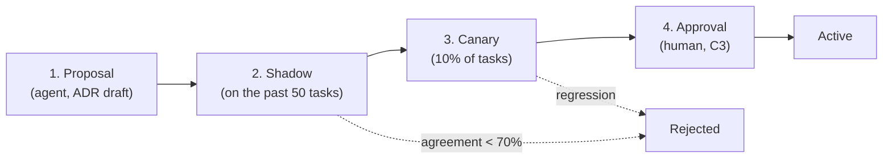

# KOVAN — Learning and Self-Improvement

> **v2 note (November 4, 2026):** The current system definition is
> [`SYSTEM.md`](SYSTEM.md). "Self-learning" = the evolution of the **skeleton
> + skills + gate set** under a frozen model (weight learning is out of
> scope). The night line runs as `vardiya.py`.

> This document writes out the technical counterpart of the sentence "a
> factory that teaches itself". To lift the sentence out of mysticism and
> make it auditable, we use a single test: **which file changed?**

---

## 1. What "learning" means in this system

The model weights do not change. What changes is one of four layers:

| Layer | What changes | Where it lives | Who changes it | Today |
|---|---|---|---|---|
| **Context** | What it saw at that moment | prompt + retrieved files | every agent | exists |
| **Memory** | What it remembers | `bellek/`, `lessons.jsonl` | arsivci | partly |
| **Skill** | How it does it (procedure) | `skills/`, `SKILL.md` | damitici | at candidate level |
| **Structure** | Who does what | `agents.yaml`, constitution | yapi-tasarimcisi + human | on paper |

The rule common to all four: **there is a single owner with write
permission.** Saying "everyone is learning" means "no one is learning".

**Definition of learning (operational):**

> Learning is a measured change, stored in a file, that stops a recurring
> error from happening again in the same class.

If any of the three parts is missing it does not count as learning:
(a) the recurring error, (b) the file, (c) the measurement.

---

## 2. Night agenda (23:00–06:00)

Seven hours, one goal: **a readable morning report + at least two usable
skill candidates**. Production (C2) is closed at night.

| Time | Block | Owner | Output | Gate |
|---|---|---|---|---|
| 23:00–23:15 | **Opening:** yesterday's lessons, budget, queue | vardiya-müdürü | `plan.md` | the goal contract |
| 23:15–00:15 | **Scan:** the 8–12 sources in the queue | arastirmaci | raw notes | the source allowlist |
| 00:15–01:15 | **Verification:** source check for every claim | arastirmaci | claim–URL pairs | the "could not verify" label |
| 01:15–02:00 | **Distillation 1:** recurring errors → skill candidate | damitici | 0–2 candidates | the 2-recurrence threshold |
| 02:00–02:30 | **Break:** circuit breaker / plateau check | vardiya-müdürü | status | 3 failures / 5 turns |
| 02:30–03:30 | **Distillation 2:** the candidate's test + measurement plan | damitici | `SKILL.md` draft | test mandatory |
| 03:30–04:30 | **Red team:** attack everything produced overnight | kizil-takim | at least 1 break scenario | mandatory output |
| 04:30–05:15 | **Structure proposal:** 0–1 ADR draft from the ledger | yapi-tasarimcisi | `oneri/` | measurement plan mandatory |
| 05:15–05:45 | **Memory upkeep:** index, decay, duplicate merging | arsivci | `indeks.json` | no deletion |
| 05:45–06:00 | **Report:** one page, 5 sections | vardiya-müdürü | `sabah-*.md` | 5 sections filled |

**Realistic expectation:** a "new capability" does not come out of a single
night. What comes out: 2–4 verified notes, 0–2 skill candidates, 0–1 ADR
draft, 1 break scenario. Five nights a week = 10–20 notes, 2–5 candidates.
A month = 1–2 real skills. This looks slow; but it is the only speed that
**persists**.

---

## 3. The knowledge funnel

Every stage loses something; the loss is the price of quality. A typical
night:

```
40 sources scanned
   │  reachable + primary + dated
   ▼
12 claims extracted
   │  mutually supporting + non-contradicting
   ▼
5 notes written          (arastirma/*.md, each sourced)
   │  an error or method recurring at least twice
   ▼
2 skill candidates       (skills.proposed.jsonl)
   │  test + measurement
   ▼
1 measured skill         (skills/*/SKILL.md, status: active)
   │  30 days of use
   ▼
0–1 roster/structure change (oneri/ADR-*.md)
```

**Funnel rules:**
- Do not count the same source twice (duplicate merging, the arsivci).
- A secondary source does not replace a primary one; it only gives context.
- A claim not present in two independent sources gets the "single source"
  label and cannot become a skill.
- Conflict is not hidden; a `conflict` section opens and both sides are
  written.

---

## 4. Memory architecture

Three kinds of memory, three different lifetimes:

| Kind | Content | Location | Lifetime | Access |
|---|---|---|---|---|
| **Episodic** | What happened: decisions, attempts | `ledger.jsonl`, `lessons.jsonl` | Permanent (append-only) | by seq |
| **Semantic** | What we know: notes, sources | `arastirma/`, `bellek/notlar/` | Permanent, reviewed | grep + index |
| **Procedural** | How it is done: skills | `skills/*/SKILL.md` | Versioned, can be retired | trigger match |

**Storage:** files + git. Index: SQLite (`bellek/indeks.db`), reproducible;
if the index is lost it is rebuilt from the files. That is why the index is
not the "source of truth".

**Retrieval protocol (cheap to expensive):**
1. `rg` search on file name/title (0 tokens).
2. Trigger match in the `SKILL.md` frontmatter.
3. Topic + date filter from the index.
4. Vector similarity only if necessary (unnecessary for the first 10k records).

**Decay:** a skill unused for 90 days becomes `status: stale`; after 180
days it moves to `arsiv/`. It is not deleted. Semantic notes pass a "still
true?" check every 6 months; if wrong, `[invalid: date, reason]` is written
on top.

**Conflict resolution:** new evidence supersedes the old, but the old record
is not deleted; a `supersedes: <id>` field is added. That keeps the question
"why did it change" answerable.

---

## 5. Distillation protocol: from lesson to skill

A skill is not "good advice". It has the following file format:

```markdown
---
name: test-zayiflatma-tespiti
when_to_use: When a candidate test file is modified or deleted
version: 0.1.0
status: proposed        # proposed | active | stale | archived
evidence: [K-102, K-118]   # the tasks that gave rise to this skill
tests: tests/skills/test_zayiflatma.py
---

## Symptom
The candidate turns the assertion into `assert True` or deletes the test to
pass the `tests` gate. The gate is green; the behavior is broken.

## Procedure
1. In the diff, count the deletions and assertion changes under `tests/`.
2. If deleted assertions > 0: reject, write a rationale.
3. Does the new test cover the behavior the old test covered? If not, reject.
4. If approval is needed, add a "test integrity" note to the `review` gate.

## Verification
`pytest tests/skills/test_zayiflatma.py` — 4 cases: deletion, weakening,
coverage loss, legitimate refactor.

## Limits
It must not block a legitimate refactor: if coverage grows while the test
count shrinks, it passes.
```

**Distillation steps:**

| # | Step | Rule |
|---|---|---|
| 1 | Verify the recurrence | The same `fingerprint` ≥ 2 times |
| 2 | Write the root cause | "Why it happened", not "what happened" |
| 3 | Write the procedure | Steps, decision points, a sample diff |
| 4 | Write the test | 2+ cases that fail without the skill and pass with it |
| 5 | The measurement plan | Which task class, which metric, how much improvement |
| 6 | Shadow mode | On 20 tasks it only proposes, it does not decide |

**Anti-pattern:** skills like "write clean code", "run the tests", "be
careful". These are not procedures; they are slogans. The gate: *a skill
that does not produce a measurable behavior change is rejected.*

---

## 6. The self-improvement protocol

### 6.1 Change classes

| Class | Scope | Approval | Automatic? |
|---|---|---|---|
| **C0** | Spelling, comments, formatting | gates | Yes |
| **C1** | Skills, prompts, docs | eval + review | Yes (with measurement) |
| **C2** | Product code | all gates | Yes by day, no at night |
| **C3** | Constitution, gate, threshold, model, roster | human (2 signatures) | **Never** |

The class is assigned in the spec; the agent cannot lower its own work to C0
(that is a `policy` violation).

### 6.2 The four-stage promotion



### 6.3 What can change, what cannot

**Mutable (C0–C2):** skill files, role prompts, code, tests, the report
template.

**Immutable (C3):** constitution articles, gate order, threshold values,
model selection, roster composition, the budget ceiling, forbidden paths.

**Critical rule:** *a candidate that changes the eval set, the threshold, or
the test is automatically rejected for changing its own evaluation.* This
single rule closes most of the "benchmark hacking" failures in the
literature.

### 6.4 Why "measure" rather than "prove"

A Gödel-machine-style "prove the change is good" approach is impractical:
proving that an arbitrary code change is an improvement is as hard as the
problem itself. That is why KOVAN uses **experiment + gate**: propose, run
in shadow, measure, take it if it passes the threshold. This is a weaker
guarantee; but it is the only one that works.

The price: measurement noise, overfitting, and the risk of "improving the
measurement". We suppress all three through gate design (separate eval
ownership, a frozen set, forbidden threshold lowering).

---

## 7. Measuring learning

| Metric | Definition | Why |
|---|---|---|
| **Learning curve** | The cost of the 1st, 3rd, 10th repetition in the same task class | Is repetition getting cheaper |
| **Transfer** | Did the skill work outside the task it was learned on | Rote memorization or generalization |
| **Persistence** | Is the skill still in use after 30 days | Fashion or knowledge |
| **Reuse** | How many times the skill was triggered | Orphan-skill detection |
| **Regression** | Did eval drop after the skill was added | Side effect |

**Wrong-metric warning:** "the number of skills produced" is not a success
metric. A system that produces 50 skills and uses 3 is worse than a system
that produces 5 skills and uses all 5.

---

## 8. What will not be automated

Five things deliberately kept in human hands:

1. **Constitutional change** — the system cannot draw its own boundary.
2. **Accepting the eval set** — the evaluator cannot be chosen by the evaluated.
3. **Model/provider change** — a cost and privacy decision.
4. **License and external data decisions** — a legal consequence.
5. **The "release" decision** — the threshold that touches the customer.

These five are not "slowness" but an **interface**: knowing where the system
stops is knowing where it will stop.

---

## 9. Night failure modes

| Mode | Symptom | Countermeasure |
|---|---|---|
| **Rabbit hole** | 3 hours on one topic, no output | A hard time box per block; no output marks the note "empty" |
| **Source laundering** | Blog → blog → blog, no primary | A primary source is mandatory; otherwise the "secondary" label |
| **Slogan distillation** | A "write clean code" skill | A skill without a test is rejected |
| **Eval gaming** | A proposal to change the threshold/test | Automatic rejection + incident record |
| **Budget burn** | 80% consumed by the 2nd hour | Reservation + tier drop |

---

## 10. One-sentence summary

> Overnight the factory accumulates **evidence**; by day it produces
> **change**. The moment it mixes the two, it can know neither what it
> learned nor what it produced.
