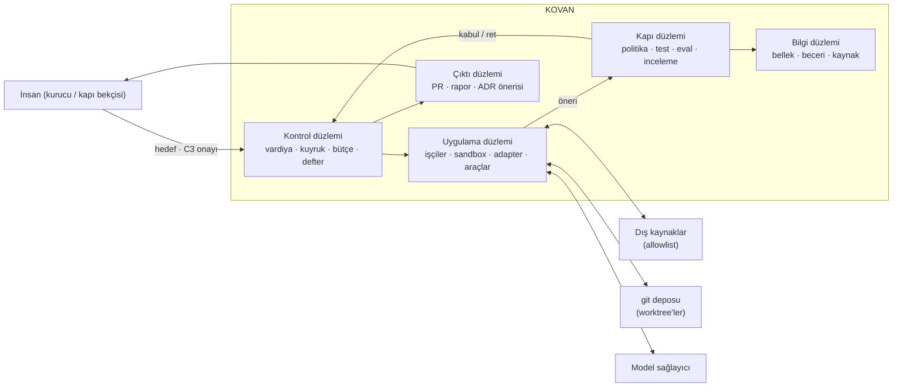
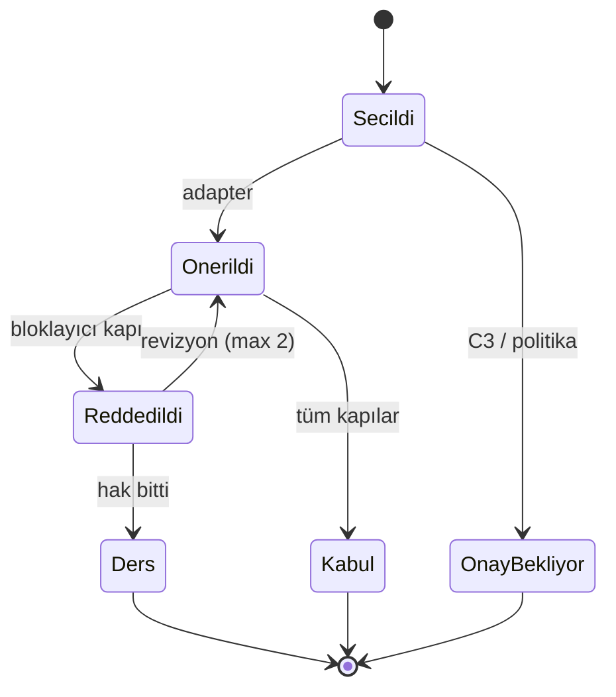

# KOVAN — Mimari

> Bu belge **ne inşa edileceğini** anlatır; neden böyle karar verildiği
> [`ADR.md`](ADR.md) içinde. Kodun bugünkü hâli `loop/` altında ve yalnızca
> Halka 1'in iskeletini kapsıyor.

---

## 1. Tasarım kısıtları

Mimari şu beş kısıt altında şekillendi. Hepsi bilinçli; hiçbiri "şimdilik böyle".

| # | Kısıt | Sonuç |
|---|---|---|
| K1 | **Tek doğruluk kaynağı git'tir** | Durum dosyaları, spec, beceri, rapor: hepsi repoda, versiyonlu, diff'lenebilir |
| K2 | **Model değiştirilebilir olmalı** | Her model çağrısı `Adapter` arkasında; hiçbir mantık sağlayıcıya gömülmez |
| K3 | **Fail-closed** | Karar verilemiyorsa durur, devam etmez (Airlock ile aynı ilke) |
| K4 | **Kesinti normaldir** | Her tur yeniden başlatılabilir; yan etkiler idempotent |
| K5 | **Tek repo ile başla** | Çok repolu orkestrasyon, tek repoda doğrulanmadan gelmez |

---

## 2. Sistem bağlamı



---

## 3. Bileşenler

| Bileşen | Düzlem | Sorumluluk | Girdi → Çıktı | Bugün |
|---|---|---|---|---|
| **Vardiya** | kontrol | Tur döngüsü, görev seçimi, durma kuralları | goal+backlog → kararlar | `runner.py` (var) |
| **Kuyruk** | kontrol | Öncelik, bağımlılık, inceleme bütçesi | issue listesi → sıralı görev | YAML (var, basit) |
| **Bütçe** | kontrol | Token/USD muhasebesi, kademe düşürme | kullanım → uyarı/dur | Sayaç (var) |
| **Defter** | kontrol | Append-only karar kaydı, hash zinciri | karar → kayıt | `Ledger` (var) |
| **İşçi** | uygulama | Bir rolün sözleşmesini yürütür | görev → aday değişiklik | Yok (adapter boş) |
| **Sandbox** | uygulama | Konteyner + worktree + ağ allowlist | iş → izole ortam | Tanım var, kod yok |
| **Adapter** | uygulama | Model çağrısı, araç yürütme | prompt+araç → çıktı | Arayüz var |
| **Araçlar** | uygulama | Dosya, shell, arama, MCP | çağrı → sonuç | Airlock üzerinden (planlı) |
| **Politika** | kapı | Yasak yol/izin denetimi | diff/çağrı → allow/ask/block | Kural (var), Airlock (ayrı repo) |
| **Kapı motoru** | kapı | Sıralı, fail-fast değerlendirme | aday → kapı sonuçları | `evaluate()` (var) |
| **Eval** | kapı | Regresyon seti, eşik, kanarya | sürüm → skor | Yok |
| **İnceleme** | kapı | Bağımsız bağlamda gerekçeli onay | patch → ret/onay | Yok |
| **Bellek** | bilgi | Not, ders, indeks, çürüme | kayıt → aranabilir bilgi | JSONL (var) |
| **Beceri** | bilgi | Prosedür kütüphanesi (SKILL.md) | ders → beceri | Aday kaydı (var) |
| **Rapor** | çıktı | Tek sayfa sabah raporu | vardiya → md | `demo.py` (var) |

---

## 4. Görev yaşam döngüsü



Durum geçişleri deftere yazılır. Bir görev aynı anda iki durumda olamaz:
seçim tek iş parçacıklıdır (tek yazıcı kuralı, bkz. §8).

---

## 5. Depo yerleşimi (hedef)

```
kovan/
  anayasa/            # değişmez: madde 1-10, kapı tanımları
  loop/               # koşucu, hedef, kapılar, kadro (bugün burada)
    goal.yaml
    gates.yaml
    agents.yaml
    constitution.md
    runner.py
    ledger.jsonl      # üretilen
    lessons.jsonl
    skills.proposed.jsonl
  kadro/              # rol prompt'ları + SKILL.md dosyaları
    incelemeci/SKILL.md
    damitici/SKILL.md
  skills/             # aktif beceriler (ölçülmüş)
  specs/              # görev başına spec + kabul kriteri
  bellek/             # indeks (sqlite) + notlar (md)
  arastirma/          # kaynaklı notlar
  olcum/              # regresyon setleri, eval koşumu
  rapor/              # sabah-YYYY-MM-DD.md
  oneri/              # ADR taslakları
  arac/               # CLI
```

**Kural:** `anayasa/` ve `loop/goal.yaml` yazma yasaklıdır (politika kapısı).
`skills/` yalnızca damitici tarafından, ölçüm kaydıyla yazılır.

---

## 6. Dört halkanın teknik karşılığı

| Halka | Tetikleyici | Durum | Çıktı | Başarısızlık davranışı |
|---|---|---|---|---|
| H1 Görev | kuyrukta iş | `state.json` + defter | patch/PR | revizyon → ders → sıradaki |
| H2 Vardiya | cron 23:00 | vardiya dosyası | rapor + beceri adayı | bütçe biterse kısmi rapor |
| H3 Sürüm | beceri/sürüm onayı | sürüm kaydı + eval | kanarya | eşik altı → otomatik geri alma |
| H4 Yapı | haftalık | ledger + metrik | ADR taslağı | ölçüm yoksa öneri reddedilir |

H2 ve H4 **yazma yetkisi olmayan** halkalardır: yalnızca öneri üretirler.
Bu, "gece üretim yapılmaz" kuralının mimari karşılığıdır.

---

## 7. Veri modeli (minimum)

```jsonc
// defter kaydı
{"seq": 12, "ts": 1792..., "prev": "sha256...", "payload": {
  "type": "decision", "task": "K-102", "kind": "accepted",
  "reason": "tüm kapılar geçti",
  "gates": [{"gate":"tests","ok":true,"blocking":true,"detail":"geçti"}]
}, "hash": "sha256..."}

// ders
{"task":"K-102","gate":"tests","detail":"başarısız","fingerprint":"a1b2c3d4e5f6","seen":2}

// beceri adayı
{"kind":"skill_candidate","fingerprint":"a1b2c3d4e5f6","gate":"tests",
 "symptom":"başarısız","status":"proposed","needs":"gece_vardiyasi_damitma"}
```

Şema değişikliği C3: defteri okuyan araçları kırar.

---

## 8. Eşzamanlılık ve çakışma

Araştırma bulgusu: aynı repoda eşzamanlı ajan PR'larının çakışma oranı,
çapraz-ajan çiftlerinde aynı-ajan çiftlerinin iki katı. Bu yüzden:

- **Tek yazıcı:** aynı anda yalnızca bir işçi `main`'e yakın dallara yazar.
- **Worktree izolasyonu:** her işçi kendi worktree'sinde; ortak dosya yok.
- **Dosya kilidi:** spec'te listelenen dosyalar iş süresince kilitli (lease).
- **Küçük PR:** hedef ≤ 400 satır diff; üstü otomatik bölünür.
- **Eşzamanlılık tavanı:** gece 3, gündüz 5. Gerekçe: inceleme kapasitesi.

---

## 9. Dayanıklılık

| Risk | Önlem | Test |
|---|---|---|
| Süreç ölür | `state.json` + `resume` | `test_resume_skips_completed_tasks` |
| Aynı iş iki kez | görev kimliği + defter kontrolü | (v0.2) |
| Defter bozulur | hash zinciri + `verify` | `test_tampering_is_detected` |
| Model yanıt vermez | 2 deneme + kademe düşürme | (v0.2) |
| Bütçe kaçar | tur başına rezervasyon | `test_budget_exhaustion_stops` |
| Ajan kilitlenir | duvar saati + `STOP` | `test_human_stop_file` |

---

## 10. Gözlemlenebilirlik

Her tur için tek span, şu alanlarla (OpenTelemetry GenAI semantiğine uyumlu):

```
kovan.task            {id, class, priority, estimate_tokens}
kovan.gate            {name, ok, blocking, duration_ms}
kovan.model           {provider, model, tier, input_tokens, output_tokens, cached}
kovan.decision        {kind, reason_code}
kovan.ledger          {seq, hash_ok}
```

Kural: **log, karar değildir.** Karar defterde; log yalnızca hata ayıklama içindir.
Defter ile log çelişirse defter doğrudur.

---

## 11. Teknoloji seçimleri

| Alan | Seçim | Neden |
|---|---|---|
| Orkestrasyon | Python 3.13, tek süreç | Anlaşılabilir; 300 satırda okunur |
| Kalıcılık | Dosya + git + SQLite indeks | K1; ayrı sunucu yok |
| Kuyruk | YAML/JSONL | İnsan düzenleyebilir; diff'lenebilir |
| Model | Sağlayıcı-bağımsız adapter | K2 |
| İzolasyon | Docker/devcontainer + git worktree | Bugün en taşınabilir seçenek |
| Politika | Airlock (mevcut çekirdek) | Aynı hash-zinciri deseni |
| Eval | pytest + JSONL regresyon setleri | Deterministik, ucuz, okunur |
| Rapor | Markdown | Git'te diff'lenir, insan okur |

**Alınmayanlar:** Temporal/Airflow (K5: tek repo için ağır), vektör veritabanı
(ilk 10k kayıt için grep yeterli), Kafka, Kubernetes.

---

## 12. Bilinen zayıflıklar (mimari borç)

1. **Koşucu sıralı.** Paralel işçi yok; eşzamanlılık bölümü henüz kâğıtta.
2. **Adapter yok.** Gerçek model bağlanmadı; tüm sinyaller senaryodan geliyor.
3. **Defter O(n²).** Her eklemede dosya baştan okunuyor; 10k kayıtta yavaşlar.
4. **Kilit yok.** Dosya lease mekanizması tasarlandı, uygulanmadı.
5. **Eval yok.** En kritik bileşen kâğıt üzerinde; bu yüzden "öğrenme" iddiası
   bugün yalnızca mekanizma düzeyinde doğru.
6. **Sandbox yok.** `goal.yaml`'da tanımlı; kod tarafında uygulanmadı.
7. **Politika eşleşmesi substring.** `policy` kapısı diff içinde yasak yol
   arıyor; `constitution.md` yazımını kaçırabilecek dolambaçlı yollar (ör.
   değişkenle birleştirme) teoride mümkün. Gerçek çözüm: dosya yolu
   normalizasyonu + AST değil, en azından yol bileşeni eşleşmesi (v0.2).

Bu liste [`SELF-REVIEW.md`](SELF-REVIEW.md) ile aynı kaynaktan besleniyor:
mimari borç gizlenmez, sıralanır.
