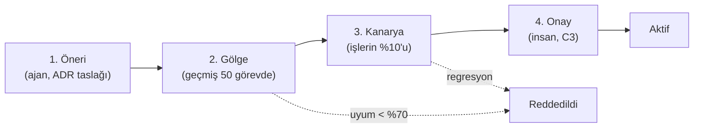

# KOVAN — Öğrenme ve Kendini Geliştirme

> **v2 notu (4 Kasım 2026):** Güncel sistem tanımı [`SYSTEM.md`](SYSTEM.md).
> "Kendi kendine öğrenme" = donmuş model altında **iskelet + beceri + kapı
> seti evrimi** (ağırlık öğrenmesi kapsam dışı). Gece hattı `vardiya.py`
> olarak çalışıyor.

> Bu belge, "kendi kendine öğrenen fabrika" cümlesinin teknik karşılığını
> yazıyor. Cümleyi mistiklikten çıkarıp denetlenebilir hale getirmek için tek
> bir test kullanıyoruz: **hangi dosya değişti?**

---

## 1. Bu sistemde "öğrenme" ne demek

Model ağırlıkları değişmiyor. Değişen şey dört katmandan biri:

| Katman | Ne değişir | Nerede durur | Kim değiştirir | Bugün |
|---|---|---|---|---|
| **Bağlam** | O an ne gördüğü | prompt + getirilen dosyalar | her ajan | var |
| **Bellek** | Ne hatırladığı | `bellek/`, `lessons.jsonl` | arşivci | kısmen |
| **Beceri** | Nasıl yaptığı (prosedür) | `skills/`, `SKILL.md` | damitici | aday düzeyinde |
| **Yapı** | Kimin ne yaptığı | `agents.yaml`, anayasa | yapi-tasarimcisi + insan | kâğıtta |

Dördünün ortak kuralı: **yazma izni olan tek bir sahibi var.** "Herkes
öğreniyor" demek, "kimse öğrenmiyor" demektir.

**Öğrenme tanımı (operasyonel):**

> Öğrenme, tekrar eden bir hatanın aynı sınıfta bir daha oluşmamasını sağlayan,
> bir dosyada duran ve ölçülmüş bir değişikliktir.

Üç parça eksikse öğrenme sayılmaz: (a) tekrar eden hata, (b) dosya, (c) ölçüm.

---

## 2. Gece ajandası (23:00–06:00)

Yedi saat, tek hedef: **sabah okunabilir bir rapor + en az iki kullanılabilir
beceri adayı**. Üretim (C2) gece kapalı.

| Saat | Blok | Sahip | Çıktı | Kapı |
|---|---|---|---|---|
| 23:00–23:15 | **Açılış:** dünkü dersler, bütçe, kuyruk | vardiya-müdürü | `plan.md` | hedef sözleşmesi |
| 23:15–00:15 | **Tarama:** kuyruktaki 8–12 kaynak | arastirmaci | ham notlar | kaynak allowlist |
| 00:15–01:15 | **Doğrulama:** her iddia için kaynak kontrolü | arastirmaci | iddia-URL çiftleri | "doğrulanamadı" etiketi |
| 01:15–02:00 | **Damıtma 1:** tekrar eden hatalar → beceri adayı | damitici | 0–2 aday | 2-tekrar eşiği |
| 02:00–02:30 | **Ara:** devre kesici / plato kontrolü | vardiya-müdürü | durum | 3 hata / 5 tur |
| 02:30–03:30 | **Damıtma 2:** adayın testi + ölçüm planı | damitici | `SKILL.md` taslağı | test zorunlu |
| 03:30–04:30 | **Kırmızı takım:** gece üretilen her şeye saldırı | kizil-takim | en az 1 kırılma senaryosu | zorunlu çıktı |
| 04:30–05:15 | **Yapı önerisi:** ledger'dan 0–1 ADR taslağı | yapi-tasarimcisi | `oneri/` | ölçüm planı zorunlu |
| 05:15–05:45 | **Bellek bakımı:** indeks, çürüme, tekrar birleşimi | arsivci | `indeks.json` | silme yok |
| 05:45–06:00 | **Rapor:** tek sayfa, 5 bölüm | vardiya-müdürü | `sabah-*.md` | 5 bölüm dolu |

**Gerçekçi beklenti:** Bir gecede "yeni bir yetenek" çıkmaz. Çıkan şey:
2–4 doğrulanmış not, 0–2 beceri adayı, 0–1 ADR taslağı, 1 kırılma senaryosu.
Haftada 5 gece = 10–20 not, 2–5 aday. Bir ay = 1–2 gerçek beceri.
Bu yavaş görünüyor; ama **kalıcı** olan tek hız bu.

---

## 3. Bilgi hunisi

Her aşamada kayıp var; kayıp, kalitenin fiyatıdır. Tipik bir gece:

```
40 kaynak tarandı
   │  erişilebilir + birincil + tarihli
   ▼
12 iddia çıkarıldı
   │  birbirini destekleyen + çelişmeyen
   ▼
5 not yazıldı            (arastirma/*.md, her biri kaynaklı)
   │  en az 2 kez tekrar eden hata veya yöntem
   ▼
2 beceri adayı           (skills.proposed.jsonl)
   │  test + ölçüm
   ▼
1 ölçülmüş beceri        (skills/*/SKILL.md, status: active)
   │  30 gün kullanım
   ▼
0–1 kadro/yapı değişikliği (oneri/ADR-*.md)
```

**Huni kuralları:**
- Aynı kaynağı iki kez saymayın (tekrar birleştirme, arşivci).
- İkincil kaynak, birincil kaynağın yerine geçmez; yalnızca bağlam verir.
- Bir iddia iki bağımsız kaynakta yoksa "tek kaynak" etiketi alır ve beceriye
  dönüşemez.
- Çelişki gizlenmez; `çelişki` bölümü açılır ve iki taraf da yazılır.

---

## 4. Bellek mimarisi

Üç tür bellek, üç farklı ömür:

| Tür | İçerik | Yer | Ömür | Erişim |
|---|---|---|---|---|
| **Epizodik** | Ne oldu: kararlar, denemeler | `ledger.jsonl`, `lessons.jsonl` | Kalıcı (append-only) | seq ile |
| **Semantik** | Ne biliyoruz: notlar, kaynaklar | `arastirma/`, `bellek/notlar/` | Kalıcı, gözden geçirilir | grep + indeks |
| **Prosedürel** | Nasıl yapılır: beceriler | `skills/*/SKILL.md` | Sürümlü, emekli edilebilir | tetikleyici eşleşmesi |

**Depolama:** dosya + git. İndeks: SQLite (`bellek/indeks.db`), yeniden
üretilebilir; indeks kaybolursa dosyalardan yeniden kurulur. Bu yüzden indeks
"doğruluk kaynağı" değildir.

**Getirme protokolü (ucuzdan pahalıya):**
1. `rg` ile dosya adı/başlık araması (0 token).
2. `SKILL.md` frontmatter'ında tetikleyici eşleşmesi.
3. İndeksten konu + tarih filtresi.
4. Yalnızca gerekliyse vektör benzerliği (ilk 10k kayıtta gereksiz).

**Çürüme (decay):** 90 gün kullanılmayan beceri `status: stale` olur; 180 gün
sonra `arsiv/`'e taşınır. Silinmez. Semantik notlar 6 ayda bir "hâlâ doğru mu"
kontrolünden geçer; yanlışsa üstüne `[geçersiz: tarih, neden]` yazılır.

**Çelişki çözümü:** Yeni kanıt eskiyi geçersiz kılar, ama eski kayıt silinmez;
`supersedes: <id>` alanı eklenir. Böylece "neden değişti" sorusu cevaplanabilir.

---

## 5. Damıtma protokolü: dersten beceriye

Bir beceri, "iyi tavsiye" değildir. Şu dosya biçimine sahiptir:

```markdown
---
name: test-zayiflatma-tespiti
when_to_use: Bir aday test dosyasını değiştirdiğinde veya sildiğinde
version: 0.1.0
status: proposed        # proposed | active | stale | archived
evidence: [K-102, K-118]   # bu beceriyi doğuran görevler
tests: tests/skills/test_zayiflatma.py
---

## Semptom
Aday, `tests` kapısını geçmek için assertion'ı `assert True` yapıyor veya
testi siliyor. Kapı yeşil, davranış bozuk.

## Prosedür
1. Diff'te `tests/` altındaki silme ve assertion değişimini say.
2. Silinen assertion > 0 ise: reddet, gerekçe yaz.
3. Yeni test, eski testin kapsadığı davranışı kapsıyor mu? Kapsamıyorsa reddet.
4. Onay gerekiyorsa `review` kapısına "test bütünlüğü" notu ekle.

## Doğrulama
`pytest tests/skills/test_zayiflatma.py` — 4 vaka: silme, zayıflatma,
kapsam kaybı, meşru refactor.

## Sınırlar
Meşru refactor'ü engellememeli: test sayısı azalırken kapsam artıyorsa geçer.
```

**Damıtma adımları:**

| # | Adım | Kural |
|---|---|---|
| 1 | Tekrarı doğrula | Aynı `fingerprint` ≥ 2 kez |
| 2 | Kök nedeni yaz | "Neden oldu", "ne oldu" değil |
| 3 | Prosedürü yaz | Adımlar, karar noktaları, örnek diff |
| 4 | Testi yaz | Beceri olmadan başarısız, beceriyle geçen 2+ vaka |
| 5 | Ölçüm planı | Hangi görev sınıfında, hangi metrikle, ne kadar iyileşme |
| 6 | Gölge mod | 20 görevde yalnızca öneri üretir, karar vermez |

**Anti-pattern:** "Temiz kod yaz", "testleri çalıştır", "dikkatli ol" gibi
beceriler. Bunlar prosedür değil; slogan. Kapı: *beceri, ölçülebilir bir
davranış değişikliği üretmiyorsa reddedilir.*

---

## 6. Kendini geliştirme protokolü

### 6.1 Değişiklik sınıfları

| Sınıf | Kapsam | Onay | Otomatik mi |
|---|---|---|---|
| **C0** | Yazım, yorum, biçim | kapılar | Evet |
| **C1** | Beceri, prompt, doküman | eval + inceleme | Evet (ölçümle) |
| **C2** | Ürün kodu | tüm kapılar | Gündüz evet, gece hayır |
| **C3** | Anayasa, kapı, eşik, model, kadro | insan (2 imza) | **Asla** |

Sınıf ataması spec'te yapılır; ajan kendi işini C0'a düşüremez (bu bir
`policy` ihlalidir).

### 6.2 Dört aşamalı yükseltme



### 6.3 Ne değişebilir, ne değişemez

**Değişebilir (C0–C2):** beceri dosyaları, rol prompt'ları, kod, testler, rapor şablonu.

**Değişemez (C3):** anayasa maddeleri, kapı sırası, eşik değerleri, model
seçimi, kadro kompozisyonu, bütçe tavanı, yasak yollar.

**Kritik kural:** *Eval setini, eşiği veya testi değiştiren aday, kendi
değerlendirmesini değiştirdiği için otomatik reddedilir.* Bu tek kural,
literatürdeki "benchmark hackleme" arızalarının çoğunu kapatır.

### 6.4 Neden "kanıtla" değil "ölç" ile

Gödel makinesi tarzı "değişikliğin iyi olduğunu kanıtla" yaklaşımı pratikte
uygulanamaz: keyfi bir kod değişikliğinin iyileştirme olduğunu kanıtlamak,
problemin kendisi kadar zor. Bu yüzden KOVAN **deney + kapı** kullanır:
öner, gölgede çalıştır, ölç, eşiği geçerse al. Bu daha zayıf bir garanti;
ama çalışan tek garanti.

Bedeli: ölçüm gürültüsü, aşırı uyum ve "ölçümü iyileştirme" riski. Üçünü de
kapı tasarımıyla bastırıyoruz (ayrı eval sahipliği, dondurulmuş set, eşik
düşürmenin yasak olması).

---

## 7. Öğrenmenin ölçümü

| Metrik | Tanım | Neden |
|---|---|---|
| **Öğrenme eğrisi** | Aynı görev sınıfında 1., 3., 10. tekrarın maliyeti | Tekrar ucuzluyor mu |
| **Transfer** | Beceri, öğrenildiği görev dışında işe yaradı mı | Ezber mi, genelleme mi |
| **Kalıcılık** | 30 gün sonra beceri hâlâ kullanılıyor mu | Moda mı, bilgi mi |
| **Yeniden kullanım** | Beceri kaç kez tetiklendi | Yetim beceri tespiti |
| **Regresyon** | Beceri eklendikten sonra eval düştü mü | Yan etki |

**Yanlış ölçüm uyarısı:** "Üretilen beceri sayısı" bir başarı metriği değildir.
50 beceri üretip 3'ünü kullanan sistem, 5 beceri üretip 5'ini kullanan
sistemden kötüdür.

---

## 8. Otomatikleştirilmeyecekler

Bilinçli olarak insan elinde kalan beş şey:

1. **Anayasa değişikliği** — sistem kendi sınırını çizemez.
2. **Eval setinin kabulü** — değerlendirici, değerlendirilen tarafından seçilemez.
3. **Model/sağlayıcı değişimi** — maliyet ve gizlilik kararı.
4. **Lisans ve dış veri kararı** — hukuki sonuç.
5. **"Yayınla" kararı** — müşteriye dokunan eşik.

Bu beşi, "yavaşlık" değil **arabirim**dir: sistemin nerede durduğunu bilmesi,
nerede duracağını bilmesidir.

---

## 9. Gece başarısızlık modları

| Mod | Belirti | Önlem |
|---|---|---|
| **Tavşan deliği** | Tek konuda 3 saat, çıktı yok | Blok başına sert zaman kutusu; çıktı yoksa not "boş" |
| **Kaynak aklama** | Blog → blog → blog, birincil yok | Birincil kaynak zorunlu; yoksa "ikincil" etiketi |
| **Slogan damıtma** | "Temiz kod yaz" becerisi | Testi olmayan beceri reddedilir |
| **Eval oyunu** | Eşik/test değişikliği önerisi | Otomatik ret + olay kaydı |
| **Bütçe yakma** | 2. saate kadar %80 tüketim | Rezervasyon + kademe düşürme |

---

## 10. Tek cümlelik özet

> Fabrika, gece boyunca **kanıtı** biriktirir; gündüz **değişikliği** üretir.
> İkisini birbirine karıştırdığı anda, ne öğrendiğini ne de ürettiğini
> bilebilir.
