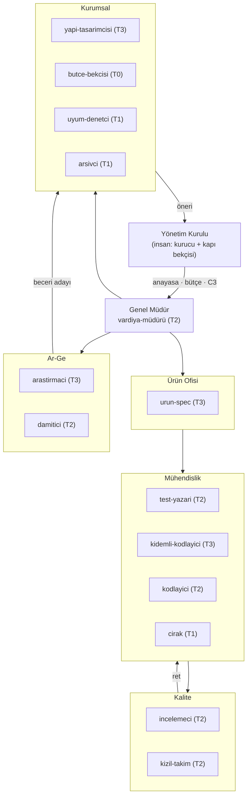
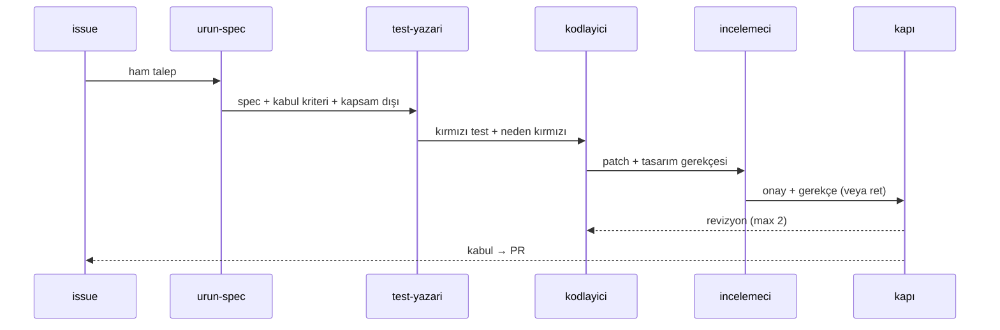

# KOVAN — Organizasyon

> **v2 notu (4 Kasım 2026):** Güncel sistem tanımı [`SISTEM.md`](SISTEM.md);
> çelişki halinde o geçerli. Bu belgedeki 14 rol → **6 rol** (İ6 inceleme
> bütçesi); devir/SLA/eskalasyon sözleşmeleri geçerlidir.

> "Şirket" burada bir metafor değil, bir **arayüz sözleşmesi**. Bir ajan
> listesi kimin neyi ne zaman devrettiğini söylemez; bir org şeması söyler.
> Bu belge, fabrikanın kimlerden oluştuğunu, kimin kime rapor verdiğini ve
> bir işin elden ele nasıl geçtiğini tanımlar.

---

## 1. Neden şirket gibi

Üç somut fayda:

1. **Devir netleşir.** "Planner → coder → reviewer" bir sıradır; "ürün → test
   yazarı → kodlayıcı → incelemeci → kapı" bir **sözleşmedir**: her adımda ne
   taşınır, ne taşınmaz yazılıdır.
2. **Sorumluluk dağılır.** Bir hata "modelin hatası" değildir; bir rolün
   sözleşmesinin ihlalidir. Bu, düzeltilebilir bir şey söyler.
3. **Kapasite ölçülür.** Her rolün bir SLA'sı ve bir darboğazı vardır.
   Şişen yer, organizasyonun nerede tıkandığını gösterir.

---

## 2. Org şeması

---

## 3. Departmanlar ve sınırlar

| Departman | Misyon | Karar yetkisi | Karar yetkisi **yok** |
|---|---|---|---|
| **Yönetim** | Vardiyayı planla, bütçeyi koru, raporu üret | Görev sırası, vardiya bitişi | Kapı geçmek, kod yazmak |
| **Ürün** | Belirsizliği sözleşmeye çevir | Kapsam, kabul kriteri | Uygulama detayı |
| **Mühendislik** | Değişikliği üret | Nasıl (tasarım) | Ne (kapsam), kabul (kapı) |
| **Kalite** | Değişikliği reddetmek | Ret gerekçesi | Kodu düzeltmek |
| **Ar-Ge** | Bilgiyi beceriye çevir | Beceri adayı | Beceriyi aktive etmek |
| **Kurumsal** | Sistemi ve kaydı koru | Bütçe kesme, uyum bloğu | Üretim kararı |

**Ayrılık kuralı (anayasa m.2):** Ürün "ne" der, mühendislik "nasıl" der,
kalite "oldu mu" der. Üçü aynı ajan olamaz.

---

## 4. Kadro

Toplam **14 ajan + 2 insan**. Sayı bilinçli: 20 ajanlık bir kadro, 20 kişilik
bir inceleme kuyruğu demektir (İ6).

| # | Rol | Departman | Model | Rapor verir | SLA (hedef) | Ana çıktı |
|---|---|---|---|---|---|---|
| 1 | vardiya-müdürü | Yönetim | T2 | kurucu | Vardiya planı 10 dk | `reports/sabah-*.md` |
| 2 | urun-spec | Ürün | T3 | vardiya-müdürü | Spec 20 dk | `specs/*.md` |
| 3 | test-yazari | Mühendislik | T2 | urun-spec | Kırmızı test 30 dk | `tests/*` |
| 4 | kidemli-kodlayici | Mühendislik | T3 | urun-spec | İlk tur kapı geçme ≥ %60 | patch |
| 5 | kodlayici | Mühendislik | T2 | kidemli-kodlayici | Görev ≤ 45 dk | patch |
| 6 | cirak | Mühendislik | T1 | kodlayici | C0/C1 ≤ 10 dk | düzeltme |
| 7 | incelemeci | Kalite | T2 | kurucu (dolaylı) | İnceleme ≤ 15 dk | onay/ret + gerekçe |
| 8 | kizil-takim | Kalite | T2 | incelemeci | ≥ 1 adversarial test/vardiya | `tests/redteam/*` |
| 9 | arastirmaci | Ar-Ge | T3 | vardiya-müdürü | Not ≤ 90 dk, kaynaklı | `arastirma/*.md` |
| 10 | damitici | Ar-Ge | T2 | arastirmaci | Beceri adayı ≤ 60 dk | `skills.proposed.jsonl` |
| 11 | yapi-tasarimcisi | Kurumsal | T3 | kurucu | Haftada ≤ 2 öneri | `oneri/ADR-*.md` |
| 12 | butce-bekcisi | Kurumsal | T0 | kurucu | Sürekli | `reports/maliyet/*` |
| 13 | uyum-denetci | Kurumsal | T1 | kurucu | PR başına ≤ 2 dk | `uyum/provenance.json` |
| 14 | arsivci | Kurumsal | T1 | yapi-tasarimcisi | Haftalık | `bellek/indeks.json` |
| 15 | **kurucu** | İnsan | — | — | — | Anayasa, C3 imzası |
| 16 | **kapı bekçisi** | İnsan | — | kurucu | C3 yanıtı ≤ 24 sa | C3 ikinci imza |

Rollerin tam sözleşmesi (izin, yazma izi, başarısızlık modu) `loop/agents.yaml`
içinde makine okunur biçimde.

---

## 5. Devir sözleşmeleri

Bir iş elden ele geçerken **ne taşınır**:

| Taşınır | Taşınmaz |
|---|---|
| `spec_id`, kabul kriterleri | Tam sohbet geçmişi |
| Önceki denemeler ve ret gerekçeleri | Modelin iç düşüncesi |
| Açık sorular | Diğer ajanın "güven" ifadesi |
| Dosya listesi ve diff | Sözlü uzlaşmalar |

**Gerekçe:** Bağlam taşımak, hatayı da taşımaktır. Artefakt taşımak denetlenebilir.

---

## 6. Ritim: toplantılar yerine döngüler

| Ritim | Ne | Kim | Çıktı |
|---|---|---|---|
| **Vardiya planı** (23:00) | Gece kuyruğu, bütçe, hedef | vardiya-müdürü | `reports/plan-*.md` |
| **Sabah devri** (06:00) | Rapor + ilk 3 iş | vardiya-müdürü → insan | `reports/sabah-*.md` |
| **Günlük üretim** (09:00–18:00) | H1 görev döngüsü | mühendislik + kalite | PR'lar |
| **Haftalık retrospektif** (Cuma) | Kapı istatistiği, tekrar eden hata | damitici + insan | `bellek/retro-*.md` |
| **Aylık yapı gözden geçirme** | Kadro, eşik, metrik | yapi-tasarimcisi + kurucu | ADR taslağı |

Retrospektifin kuralı: **her retro en az bir mekanik check üretir.** "Daha
dikkatli olalım" bir çıktı değildir.

---

## 7. İşe alım ve işten çıkarma (ajan yaşam döngüsü)

Yeni bir ajan, doğrudan üretime girmez. Dört aşama:

| Aşama | Ne olur | Çıkış kriteri |
|---|---|---|
| 1. **Gölge** | Geçmiş 50 görevde çalışır, kararları kaydedilir, üretime yazmaz | Kabul edilen kararlarla uyum ≥ %70 |
| 2. **Kanarya** | İşlerin %10'unda çalışır, çıktısı insan incelemesinden geçer | 20 görevde regresyon yok |
| 3. **Aktif** | Normal kadroda | 2 hafta SLA içinde |
| 4. **Emekli** | Kaldırılır; becerileri arşivlenir | — |

**İşten çıkarma kriteri:** 30 günde (a) kabul oranı %30'un altında, (b) maliyeti
alternatifinin 2 katı, veya (c) tekrar eden aynı hata. Üçünden biri yeterli.

---

## 8. Performans karnesi

Her ajan için dört sayı; ayda bir:

| Alan | Ne | Neden |
|---|---|---|
| **Verim** | Tamamlanan görev / açılan görev | Tıkanma noktası |
| **Kalite** | İlk turda kapı geçme | Revizyon maliyeti |
| **Maliyet** | Görev başına USD | Ölçeklenebilirlik |
| **Eskalasyon** | İnsana düşen oran | Sözleşme netliği |

Karne bir sıralama değil, bir **tanı** aracıdır. "En iyi ajan" seçilmez;
"hangi rolde sistematik sorun var" bulunur.

---

## 9. Eskalasyon matrisi

| Durum | İlk yapan | Eskalasyon | Süre |
|---|---|---|---|
| Kapı çelişkisi (iki kapı farklı karar) | vardiya-müdürü | kurucu | 15 dk |
| Politika ihlali | kapı motoru | kapı bekçisi | anında |
| C3 değişiklik | yapi-tasarimcisi | kurucu + kapı bekçisi | 14 gün bekleme |
| Bütçe %100 | butce-bekcisi | vardiya-müdürü (durdur) | anında |
| Aynı hata 5. kez | damitici | kurucu (sistem arızası) | 24 sa |
| Eval düşüşü | eval | otomatik geri alma + kurucu | anında |

---

## 10. Organizasyonel anti-pattern'ler

| Anti-pattern | Belirti | Panzehir |
|---|---|---|
| **Lastik damga** | İncelemeci her şeyi onaylıyor | Gerekçe zorunlu + rastgele insan örneklemi |
| **Ajan çoğalması** | 20 rol, 40 PR/gün, 0 inceleme | İ6: inceleme bütçesi |
| **Yetim beceri** | 50 beceri, 3'ü kullanılıyor | Çürüme raporu + kullanım sayacı |
| **Sonsuz yeniden yapılanma** | Her hafta kadro değişiyor | H4: 14 gün bekleme, ≤ 2 öneri/hafta |
| **Sessiz kapsam kayması** | Spec'te olmayan dosyalar değişiyor | `policy` kapısı: dosya listesi dışı = ret |
| **Toplantı şişmesi** | Ritüel çoğalıyor, çıktı azalıyor | Her ritmin tek çıktısı var; çıktısız ritüel silinir |

---

## 11. Ticari yapı (kısa)

Fabrika kendi kendini finanse etmek zorunda; aksi halde "öğrenen sistem"
sonsuz bir Ar-Ge bütçesine dönüşür.

| Model | Ne satılır | Birim ekonomi | Risk |
|---|---|---|---|
| **İç fabrika** | Kendi ürünlerinde hız | PR başına maliyet vs insan saati | Ürün-pazar uyumu ayrı problem |
| **Hizmet** | Müşteri backlog'u | PR başına sabit fiyat | Kapsam belirsizliği |
| **Araç** | Kapı + rapor katmanı | Koltuk/ay | Model sağlayıcıya bağımlılık |

İlk 12 hafta **iç fabrika**: tek kullanıcı (kurucu), tek repo, gerçek ölçüm.
Dış satış, KKA ve MBB ölçülmeden başlamaz — ölçülmemiş vaat satılmaz.

---

## 12. Özet: bir işin fabrikadaki yolculuğu

1. Issue, kuyruğa girer; **vardiya-müdürü** öncelik verir ve sınıf (C0–C3) atar.
2. **urun-spec** kabul kriterini komuta çevirir; komutsuz kriter reddedilir.
3. **test-yazari** kırmızı testi yazar; kırmızı olduğu kaydedilir.
4. **kodlayici** patch'i üretir; kapsam dışına çıkarsa `policy` keser.
5. **incelemeci** gerekçeli karar verir; gerekçesiz onay geçersizdir.
6. **kapı motoru** sırayla çalışır; ilk bloklayıcı hatada durur.
7. Karar **deftere** yazılır; tekrar eden hata **derse**, ders **beceri adayına** dönüşür.
8. Sabah **rapor** insanın önüne gelir; insan yalnızca C3 ve istisnada karar verir.
