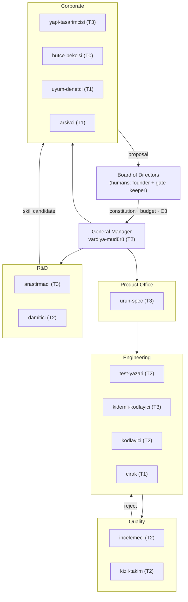
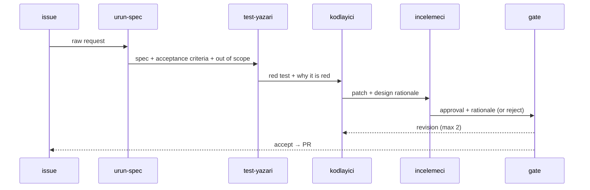

# KOVAN — Organization

> **v2 note (November 4, 2026):** The current system definition is
> [`SYSTEM.md`](SYSTEM.md); in case of conflict it wins. The 14 roles in this
> document → **6 roles** (İ6 review budget); the handoff/SLA/escalation
> contracts hold.

> "Company" here is not a metaphor but an **interface contract**. A list of
> agents does not say who handed what to whom and when; an org chart does.
> This document defines who the factory consists of, who reports to whom,
> and how a task passes from hand to hand.

---

## 1. Why company-like

Three concrete benefits:

1. **The handoff becomes explicit.** "Planner → coder → reviewer" is an
   order; "product → test writer → coder → reviewer → gate" is a
   **contract**: what moves at each step and what does not is written down.
2. **Responsibility distributes.** An error is not "the model's mistake"; it
   is the violation of a role's contract. That says something fixable.
3. **Capacity is measured.** Every role has an SLA and a bottleneck. Where
   the queue swells shows where the organization is stuck.

---

## 2. Org chart

---

## 3. Departments and boundaries

| Department | Mission | May decide | May **not** decide |
|---|---|---|---|
| **Management** | Plan the shift, guard the budget, produce the report | Task order, shift end | Passing a gate, writing code |
| **Product** | Turn ambiguity into a contract | Scope, acceptance criterion | Implementation detail |
| **Engineering** | Produce the change | How (design) | What (scope), acceptance (gate) |
| **Quality** | Reject the change | The rejection rationale | Fixing the code |
| **R&D** | Turn knowledge into skill | Skill candidate | Activating the skill |
| **Corporate** | Protect the system and the record | Budget cuts, compliance blocks | Production decisions |

**Separation rule (constitution art. 2):** Product says "what", engineering
says "how", quality says "did it hold". The three cannot be the same agent.

---

## 4. Roster

**14 agents + 2 humans** in total. The number is deliberate: a 20-agent
roster means a 20-person review queue (İ6).

| # | Role | Department | Model | Reports to | SLA (target) | Main output |
|---|---|---|---|---|---|---|
| 1 | vardiya-müdürü | Management | T2 | founder | Shift plan 10 min | `reports/sabah-*.md` |
| 2 | urun-spec | Product | T3 | vardiya-müdürü | Spec 20 min | `specs/*.md` |
| 3 | test-yazari | Engineering | T2 | urun-spec | Red test 30 min | `tests/*` |
| 4 | kidemli-kodlayici | Engineering | T3 | urun-spec | First-pass gate rate ≥ 60% | patch |
| 5 | kodlayici | Engineering | T2 | kidemli-kodlayici | Task ≤ 45 min | patch |
| 6 | cirak | Engineering | T1 | kodlayici | C0/C1 ≤ 10 min | fix |
| 7 | incelemeci | Quality | T2 | founder (indirect) | Review ≤ 15 min | approve/reject + rationale |
| 8 | kizil-takim | Quality | T2 | incelemeci | ≥ 1 adversarial test/shift | `tests/redteam/*` |
| 9 | arastirmaci | R&D | T3 | vardiya-müdürü | Note ≤ 90 min, sourced | `arastirma/*.md` |
| 10 | damitici | R&D | T2 | arastirmaci | Skill candidate ≤ 60 min | `skills.proposed.jsonl` |
| 11 | yapi-tasarimcisi | Corporate | T3 | founder | ≤ 2 proposals/week | `oneri/ADR-*.md` |
| 12 | butce-bekcisi | Corporate | T0 | founder | Continuous | `reports/maliyet/*` |
| 13 | uyum-denetci | Corporate | T1 | founder | ≤ 2 min per PR | `uyum/provenance.json` |
| 14 | arsivci | Corporate | T1 | yapi-tasarimcisi | Weekly | `bellek/indeks.json` |
| 15 | **founder** | Human | — | — | — | Constitution, C3 signature |
| 16 | **gate keeper** | Human | — | founder | C3 response ≤ 24 h | Second C3 signature |

The roles' full contracts (permissions, write footprint, failure mode) live
in `loop/agents.yaml` in machine-readable form.

---

## 5. Handoff contracts

**What moves** when a task passes from hand to hand:

| Moves | Does not move |
|---|---|
| `spec_id`, acceptance criteria | The full chat history |
| Previous attempts and rejection rationales | The model's inner thoughts |
| Open questions | The other agent's expression of "trust" |
| File list and diff | Verbal understandings |

**Rationale:** Carrying context is carrying the error too. Carrying
artifacts is auditable.

---

## 6. Rhythm: cycles instead of meetings

| Rhythm | What | Who | Output |
|---|---|---|---|
| **Shift plan** (23:00) | Night queue, budget, goal | vardiya-müdürü | `reports/plan-*.md` |
| **Morning handover** (06:00) | Report + top 3 tasks | vardiya-müdürü → human | `reports/sabah-*.md` |
| **Daily production** (09:00–18:00) | R1 task loop | engineering + quality | PRs |
| **Weekly retrospective** (Friday) | Gate statistics, recurring errors | damitici + human | `bellek/retro-*.md` |
| **Monthly structure review** | Roster, thresholds, metrics | yapi-tasarimcisi + founder | ADR draft |

The retrospective's rule: **every retro produces at least one mechanical
check.** "Let's be more careful" is not an output.

---

## 7. Hiring and firing (the agent life cycle)

A new agent does not enter production directly. Four stages:

| Stage | What happens | Exit criterion |
|---|---|---|
| 1. **Shadow** | Works on the past 50 tasks, decisions recorded, writes nothing to production | Agreement with accepted decisions ≥ 70% |
| 2. **Canary** | Works on 10% of tasks, output passes human review | No regression over 20 tasks |
| 3. **Active** | On the normal roster | 2 weeks within SLA |
| 4. **Retired** | Removed; skills archived | — |

**Firing criterion:** within 30 days (a) the acceptance rate falls below
30%, (b) the cost is twice the alternative's, or (c) the same error keeps
recurring. Any one of the three suffices.

---

## 8. Performance scorecard

Four numbers per agent, once a month:

| Area | What | Why |
|---|---|---|
| **Throughput** | Tasks completed / tasks opened | The bottleneck |
| **Quality** | First-pass gate rate | The revision cost |
| **Cost** | USD per task | Scalability |
| **Escalation** | The share falling to humans | Contract clarity |

The scorecard is not a ranking; it is a **diagnostic**. We do not pick the
"best agent"; we find "which role has a systematic problem".

---

## 9. Escalation matrix

| Situation | First responder | Escalation | Time |
|---|---|---|---|
| Gate conflict (two gates decide differently) | vardiya-müdürü | founder | 15 min |
| Policy violation | gate engine | gate keeper | immediate |
| C3 change | yapi-tasarimcisi | founder + gate keeper | 14-day wait |
| Budget at 100% | butce-bekcisi | vardiya-müdürü (stop) | immediate |
| The same error a 5th time | damitici | founder (system failure) | 24 h |
| Eval drop | eval | automatic rollback + founder | immediate |

---

## 10. Organizational anti-patterns

| Anti-pattern | Symptom | Antidote |
|---|---|---|
| **Rubber stamp** | The reviewer approves everything | Mandatory rationale + random human sampling |
| **Agent proliferation** | 20 roles, 40 PRs/day, 0 reviews | İ6: the review budget |
| **Orphan skill** | 50 skills, 3 in use | Decay report + usage counter |
| **Endless reorg** | The roster changes every week | R4: 14-day wait, ≤ 2 proposals/week |
| **Silent scope drift** | Files outside the spec are changing | The `policy` gate: outside the file list = reject |
| **Meeting bloat** | Rituals multiply, output shrinks | Every rhythm has a single output; an outputless ritual is deleted |

---

## 11. Commercial structure (brief)

The factory must finance itself; otherwise the "learning system" turns into
an endless R&D budget.

| Model | What is sold | Unit economics | Risk |
|---|---|---|---|
| **Internal factory** | Speed on its own products | Cost per PR vs human hour | Product–market fit is a separate problem |
| **Service** | The customer's backlog | Fixed price per PR | Scope ambiguity |
| **Tool** | The gate + report layer | Seats/month | Dependence on the model provider |

The first 12 weeks are the **internal factory**: one user (the founder), one
repo, real measurement. External sales do not start before KKA and MBB are
measured — an unmeasured promise is not sold.

---

## 12. Summary: a task's journey through the factory

1. The issue enters the queue; the **vardiya-müdürü** sets priority and
   assigns the class (C0–C3).
2. **urun-spec** turns the acceptance criterion into a command; a
   commandless criterion is rejected.
3. **test-yazari** writes the red test; the fact that it is red is recorded.
4. **kodlayici** produces the patch; if it strays out of scope, `policy` cuts it.
5. **incelemeci** decides with a rationale; an approval without a rationale is invalid.
6. The **gate engine** runs in order; it stops at the first blocking failure.
7. The decision is written to the **ledger**; a recurring error becomes a
   **lesson**, and the lesson becomes a **skill candidate**.
8. In the morning the **report** lands in front of the human; the human
   decides only on C3 and exceptions.
