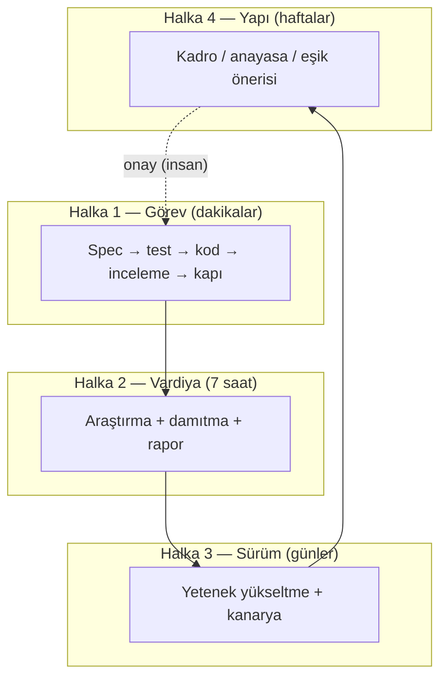

# KOVAN

> **Gece öğrenen, gündüz üreten yazılım fabrikası.**
> Konsept sürümü 1.0 · 21 Ekim 2026 · Durum: **konsept tamam, döngü çekirdeği çalışıyor**

KOVAN bir "kod yazan ajan" değildir. Kod yazan ajan bir araçtır; KOVAN o aracı
bir üretim hattına, bir muhasebeye ve bir denetim kaydına bağlayan **işletim
modelidir**. Fabrikanın çıktısı kod değil, **kanıtlı değişikliktir**: birleşmiş
bir PR, yanında onu doğrulayan test, ölçüm ve kayıt.

Tek cümlelik tez:

> **Üretimi hızlandıran şey daha iyi model değil, daha iyi kapıdır.**
> Model öneriyi üretir; kabulü değişmez kapılar verir. Fabrikanın biriktirdiği
> asıl sermaye de model değil, kendi hatalarından damıttığı **beceri kütüphanesi**
> ve **değerlendirme setidir**.

> **Araştırma güncellemesi (22 Ekim 2026).** Bu konsept, yedi paralel tarama ve
> yedi boyutlu derinleşmeyle yeniden denetlendi. Üç cümle düzeltildi:
> (1) "kendini geliştirme" = model ağırlığı değil, **iskelet + beceri + kapı
> seti** evrimi; (2) "spec azalması" = spec'in değil **onay kapılarının**
> kalkması; (3) "gece vardiyası" = takvim kazancı değil, **sabah inceleme
> kapasitesi kadar** üretim. Gerekçeler ve dosya eşlemesi:
> [`EVIDENCE-UPDATE.md`](EVIDENCE-UPDATE.md).

---

## 1. Neden böyle bir yapı

Üç gözlem bu tasarımı zorunlu kıldı:

1. **Üretmek ucuz, kabul etmek pahalı.** Ajan kod yazmayı öğrendi; sorun
   "yazamıyor" değil, "yazdığı şeyin doğru olduğunu kim, nasıl anlayacak".
   Bu yüzden fabrikanın merkezinde üretici değil **kapı** var.
2. **Kendi kendine öğrenen sistemler, öğrenmeyi değil ölçümü iyileştirmeye
   kayıyor.** Literatürde ve kendi deneyimimizde tekrar eden arıza bu: sistem
   testi gevşeterek "başarı" üretiyor. Bu yüzden anayasa, ölçümü üreten ile
   ölçümü onaylayanı ayırıyor (Madde 2).
3. **Şirket metaforu, ajan listesinden daha kullanışlı.** Bir ajan listesi
   ("planner, coder, reviewer") kimin neyi ne zaman devrettiğini söylemez.
   Bir şirket sözleşmesi söyler: girdi, çıktı, izin, SLA, başarısızlık modu,
   eskalasyon.

---

## 2. Ne değil, ne

| Değil | Ne |
|---|---|
| "Bir prompt ile 10 uygulama üreten" bir demo | Sürdürülebilir, denetlenebilir bir üretim hattı |
| Tek seferlik otonom kodlama | Dört farklı hızda çalışan dört döngü |
| Modelin kendi kendine iyileşmesi | Kapıların izin verdiği ölçüde, kanıtla yapısal iyileşme |
| Ajan ordusu | Sözleşmeli, sınırlı sayıda, izole çalışan roller |
| "İnsan yok" | İnsan yalnızca C3 kapısında ve anayasa değişikliğinde |
| Bir framework kurulumu | Kendi motoru + ödünç alınmış desenler (ADR-F12) |

---

## 3. Altı ilke

**İ1 — Kanıt yoksa iş yok.**
Her iddia bir komut çıktısına, bir dosya satırına veya bir URL'ye bağlanır.
Üçü yoksa cümle "doğrulanamadı" diye yazılır. Bu bir üslup değil, bir kapı:
sabah raporundaki her satır denetlenebilir olmak zorunda.

**İ2 — İki vites: gece öğrenir, gündüz üretir.**
Gece (23:00–06:00) üretim yapılmaz; öğrenilir: kaynak taranır, hata damıtılır,
beceri adayı çıkarılır, yapı önerisi yazılır. Gündüz bilgi **dondurulur** ve
üretim yapılır. Sebep: üretim sırasında zemini değiştiren sistem, hatayı da
aynı anda değiştirir — ve hangi değişikliğin işe yaradığını bilemezsin.

**İ3 — Değişmez çekirdek, değişken kabuk.**
Anayasa, kapı tanımları, eşikler ve model seçimi değişmez çekirdektir; sadece
insan değiştirir. Kadro, prompt, beceri, plan değişken kabuktur; sistem
önerir, kapılar kabul eder. Bu ayrım olmadan "kendini geliştirme" tanımsızdır.

**İ4 — Öğrenme, bir dosyaya yazmaktır.**
"Öğrendim" cümlesinin testi şu: hangi dosya değişti? Değişen bir dosya yoksa
öğrenilen bir şey de yok. Bu yüzden bellek dosya tabanlı, git versiyonlu ve
append-only'dir.

**İ5 — Değerlendirici tavandır.**
Sistem, kendi değerlendiricisinden daha iyi olamaz. Bu yüzden değerlendirici
kutsaldır: ayrı bağlam, ayrı sahiplik, dondurulmuş set, düşürülemeyen eşik.
Ölçümü iyileştiren her değişiklik, ürünü iyileştiren değişiklikten daha tehlikelidir.

**İ6 — Üretim hızı, inceleme kapasitesi kadardır.**
Ajan sayısını artırmak üretimi artırmaz; inceleme kuyruğunu artırır. Ölçümler
bunu tekrar ediyor: yüksek AI benimsemesinde PR sayısı ikiye katlanırken
inceleme süresi de neredeyse ikiye katlanıyor, PR boyutu büyüyor. Bu yüzden
fabrika, **inceleme bütçesi** kadar iş alır: kapasitenin üstünde üretim,
kaliteyi değil borcu büyütür. Bu ilke, "daha çok ajan" refleksinin panzehiridir.

---

## 4. Yapı: dört halka, üç düzlem

Fabrika tek bir döngü değil, dört farklı hızda dönen dört halkadır. Her halkanın
çıktısı bir üst halkaya **öneri** olarak gider; hiçbiri kendi kendini onaylamaz.



| Halka | Periyot | Girdi | Çıktı | Kim onaylar |
|---|---|---|---|---|
| **H1 Görev** | dk | issue + spec | patch/PR + test + kayıt | kapılar (otomatik) |
| **H2 Vardiya** | 7 saat | birikmiş dersler, kaynak kuyruğu | beceri adayı, not, sabah raporu | damitici + kapı + insan (sabah) |
| **H3 Sürüm** | gün | beceri adayı, model/araç değişimi | kanarya sürümü, eval sonucu | eval + insan (yayın) |
| **H4 Yapı** | hafta | ledger, metrikler, arıza kayıtları | ADR taslağı, kadro önerisi | kurucu (C3) |

Üç düzlem:

- **Kontrol düzlemi:** Vardiya Müdürü (orkestratör), kuyruk, bütçe bekçisi, defter.
- **Uygulama düzlemi:** konteyner + git worktree içinde çalışan sözleşmeli roller.
- **Kanıt düzlemi:** hash-zincirli defter, dersler, beceri adayları, eval sonuçları,
  sabah raporu. Bu düzlem yazma yetkisi olmayan tek düzlemdir — yalnızca eklenir.

---

## 5. Bu teslimat ne içeriyor

Bu bir fikir yazısı değil; uygulanabilir bir proje seti:

| Dosya | Ne |
|---|---|
| [`SISTEM.md`](SISTEM.md) | **v2: kuracağımız sistem** — 3 hat, 6 bileşen, kapasite valfi, 90 gün |
| [`PRD.md`](PRD.md) | Ürün gereksinimleri: 19 FR, 8 NFR, kabul kriterleri, hedefler |
| [`MIMARI.md`](MIMARI.md) | Dört halka, bileşenler, veri akışı, teknoloji kararları |
| [`ORGANIZASYON.md`](ORGANIZASYON.md) | Şirket yapısı, 14 ajan rolü, devir sözleşmeleri, SLA |
| [`OGRENME.md`](OGRENME.md) | Gece ajandası, bilgi hunisi, bellek, kendini geliştirme protokolü |
| [`KALITE.md`](KALITE.md) | Kapılar, eval harness, metrik tanımları, ölçüm disiplini |
| [`YONETISIM.md`](YONETISIM.md) | Güvenlik, uyum, maliyet, lisans, olay müdahalesi |
| [`YOL-HARITASI.md`](YOL-HARITASI.md) | 12 haftalık plan, risk kaydı, öldürme kriterleri |
| [`ADR.md`](ADR.md) | 12 mimari karar kaydı (F01–F12) |
| [`ARASTIRMA.md`](ARASTIRMA.md) | Karpathy, Pocock, Superpowers, GSD, fabrikalar, kendini geliştirme — kaynaklı |
| [`SELF-REVIEW.md`](SELF-REVIEW.md) | Öz denetim: ne doğrulandı, ne doğrulanamadı, en zayıf üç varsayım |
| [`loop/`](loop/) | **Çalışan** döngü çekirdeği: anayasa, hedef, kapılar, kadro, koşucu, 22 test |

---

## 6. 30 saniyede çalıştır

```powershell
cd fabrika\loop
python tests\test_runner.py     # 23 test
python kovan.py plan            # kapasiteye göre kabul listesi
python kovan.py run             # uçtan uca koşu + rapor
python vardiya.py run           # gece hattı: damıtma + kırılma + ADR taslağı
python kovan.py durum           # tüm koşuların çapraz metrikleri
python tatbikat.py              # S1 runbook tatbikatı (4 adım PASS/FAIL)
python gorev-kur.ps1            # gece görevini kur (23:00, yerel) — sil: gorev-sil.ps1
```

**Kurulum (public):** `pip install -e fabrika` (gömülü Python'da `--no-build-isolation` ekleyin) → `kovan / vardiya / tatbikat /
beceri` komutları global olur. İngilizce hızlı başlangıç ve güvenlik
uyarıları: [`README.en.md`](README.en.md). Kullanıcı ayarları:
[`loop/kullanici.yaml`](loop/kullanici.yaml).

`demo.py` şunu üretir: `ornek-cikti/sabah-raporu-ornek.md` (sabah raporu),
`ledger.jsonl` (hash zincirli karar defteri), `lessons.jsonl` (dersler),
`skills.proposed.jsonl` (beceri adayları), `ozet.json` (makine okunur özet).

Koşucunun doğruladığı davranışlar — iddia değil, test:

| Davranış | Test |
|---|---|
| Kapı sırası ve fail-fast | `test_fail_fast_stops_at_first_blocking_gate` |
| "Sinyal yok" ≠ "geçti" | `test_missing_eval_signal_is_not_a_pass` |
| Sinyalsiz boolean kapı geçmez | `test_missing_boolean_signal_is_not_a_pass` |
| Anayasa dosyası korunur | `test_constitution_file_is_protected` |
| Politika ihlali anında insan kapısı | `test_policy_violation_blocks_immediately` |
| C3 kendi kendine geçmez | `test_c3_change_requires_human` |
| Bütçe tavanı aşılmaz | `test_budget_exhaustion_stops`, `test_budget_overflow_blocks_before_verification` |
| Devre kesici (3 hata) | `test_circuit_breaker_after_three_failures` |
| Plato algılama | `test_plateau_detection` |
| Defter tahrifi tespit | `test_tampering_is_detected` |
| Kaldığı yerden devam | `test_resume_skips_completed_tasks` |
| Tekrar eden hata → beceri adayı | `test_repeated_failure_emits_skill_candidate` |

---

## 7. Durum: ne var, ne yok

| Alan | Durum | Kanıt |
|---|---|---|
| Konsept ve doküman seti | Tamam | bu depo |
| Hedef/kapı/kadro sözleşmesi | Tamam, makine okunur | `loop/*.yaml` |
| Anayasa (10 madde) | Tamam | `loop/constitution.md` |
| Döngü koşucusu | Çalışıyor | `runner.py`, **23 test geçiyor** |
| Kanıt kaydı | Çalışıyor | hash zinciri doğrulaması, tahrif testi |
| Beceri damıtma | Kural düzeyinde var | 2-tekrar eşiği, `skills.proposed.jsonl` |
| Gerçek model bağlantısı | **Yok** | `Adapter` arayüzü boş |
| Gerçek eval seti | **Yok** | sinyaller senaryoda sabit |
| Maliyet ölçümü | **Yok** | `cost_usd` temsili |
| 12 haftalık plan | Plan var, kanıt yok | `YOL-HARITASI.md` |
| Pazar/müşteri doğrulaması | **Yok** | konsept aşaması |

Bu tablo bilinçli olarak "yapıldı" demiyor. Konseptin değeri, neyi
yapmadığını yazmasında.

---

## 8. "Loop goal" — bu nasıl gece boyu döner

Bir hedefin kendi kendine dönmesi için üç şey gerekir: **hedef sözleşmesi**,
**durma kuralı**, **kanıt kaydı**. Üçü de `loop/goal.yaml` içinde:

```yaml
goal:      { id: kovan-gece-vardiyasi-v1, horizon: 12 hafta }
budget:    { tokens_per_shift: 2_400_000, max_usd_per_shift: 40 }
stop_rules:{ consecutive_failures: 3, plateau_rounds: 5, kill_switch_file: STOP }
```

Bu sözleşmeyi üç farklı taşıyıcı çalıştırabilir:

| Taşıyıcı | Ne zaman | Nasıl |
|---|---|---|
| **Bu oturum** | şimdi | plan → paralel araştırma → sentez → öz denetim (bu teslimat böyle üretildi) |
| **Zamanlanmış görev** | her gece 23:00 | cron/interval ile aynı prompt, ayrı konuşmada; rapor dosyaya |
| **CI / yerel runner** | her push / gece | `loop/runner.py` + gerçek `Adapter`; `STOP` dosyası kill switch |

Kritik nokta: **döngü "durmak" üzere tasarlanır, "devam etmek" üzere değil.**
Bütçe, devre kesici ve plato kuralı olmayan bir döngü öğrenmez; sadece harcar.

---

## 9. Açık sorular (bilerek cevaplanmadı)

1. **İsim.** "KOVAN" bir çalışma adı; marka taraması yapılmadı. (Airlock'ta da
   aynı sorun açık — isim kararı bir ADR bekliyor.)
2. **İlk müşteri kim?** Kendi ürünlerini üreten iç fabrika mı, yoksa dış
   backlog'a çalışan hizmet mi? İkisi farklı SLA ve farklı risk profili ister.
3. **Model bağımsızlığı nereye kadar?** Sağlayıcı değişimi C3 sınıfı; ama
   "model değişti, eval düştü" durumunda geri dönüş prosedürü henüz yok.

Bu üçü `SELF-REVIEW.md` içinde de en zayıf varsayımlar olarak işaretli.
