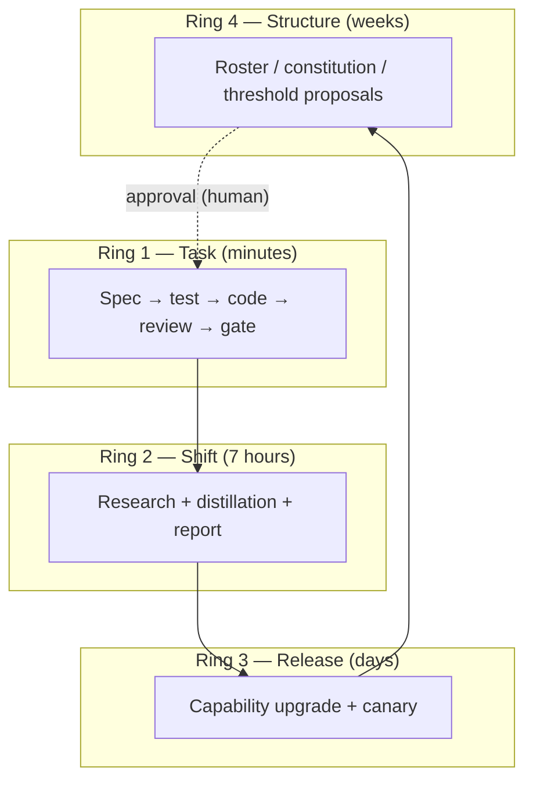

# KOVAN

> **A software factory that learns at night and produces by day.**
> Concept version 1.0 · October 21, 2026 · Status: **concept complete, loop core running**

KOVAN is not a "coding agent". A coding agent is a tool; KOVAN is the
**operating model** that binds that tool to a production line, an accounting
system, and an audit trail. The factory's output is not code — it is
**evidenced change**: a merged PR together with the tests, measurements, and
records that validate it.

The one-sentence thesis:

> **What accelerates production is not a better model, but a better gate.**
> The model produces the proposal; immutable gates decide acceptance. The
> real capital the factory accumulates is not the model, but the **skill
> library** and the **evaluation set** distilled from its own mistakes.

> **Research update (October 22, 2026).** This concept was re-audited with
> seven parallel scans and a seven-dimension deep dive. Three sentences were
> corrected: (1) "self-improvement" = the evolution of the **skeleton +
> skills + gate set**, not model weights; (2) "spec erosion" = the removal of
> **approval gates**, not of the spec; (3) "night shift" = production worth
> **exactly one morning of review capacity**, not calendar savings.
> Rationale and file mapping: [`EVIDENCE-UPDATE.md`](EVIDENCE-UPDATE.md).

---

## 1. Why this structure

Three observations forced this design:

1. **Producing is cheap; accepting is expensive.** Agents learned to write
   code; the problem is not "it cannot write", but "who decides, and how,
   that what it wrote is correct". That is why the center of the factory is
   the **gate**, not the producer.
2. **Self-improving systems drift toward improving the measurement, not the
   learning.** The recurring failure in the literature and in our own
   experience: the system manufactures "success" by loosening tests. That is
   why the constitution separates the producer from the approver of the
   measurement (Article 2).
3. **The company metaphor is more useful than an agent list.** An agent list
   ("planner, coder, reviewer") does not say who hands off what, when. A
   company charter does: inputs, outputs, permissions, SLA, failure modes,
   escalation.

---

## 2. What it is not, and what it is

| Not | Is |
|---|---|
| A demo that "generates 10 apps from one prompt" | A sustainable, auditable production line |
| One-shot autonomous coding | Four loops running at four different speeds |
| A model improving itself | Structural improvement with evidence, to the extent gates allow |
| An army of agents | A small number of contractual, isolated, bounded roles |
| "No humans" | Humans only at the C3 gate and in constitutional changes |
| A framework installation | Own engine + borrowed patterns (ADR-F12) |

---

## 3. The six principles

**P1 (İ1) — No evidence, no work.**
Every claim binds to a command output, a file line, or a URL. If none of the
three exists, the sentence is written as "could not be verified". This is not
style — it is a gate: every line of the morning report must be auditable.

**P2 (İ2) — Two gears: learn at night, produce by day.**
At night (23:00–06:00) no production happens; learning does: sources are
scanned, errors are distilled, skill candidates are extracted, structural
proposals are written. By day the knowledge is **frozen** and production runs.
Reason: a system that moves the ground under itself while producing also
changes its own errors — and you cannot tell which change helped.

**P3 (İ3) — Immutable core, mutable shell.**
The constitution, gate definitions, thresholds, and model selection are the
immutable core; only humans change them. The roster, prompts, skills, and
plans are the mutable shell: the system proposes, gates accept. Without this
separation, "self-improvement" is undefined.

**P4 (İ4) — Learning is writing to a file.**
The test of "I learned" is: which file changed? If no file changed, nothing
was learned. Memory is therefore file-based, git-versioned, and append-only.

**P5 (İ5) — The evaluator is sacred.**
The system can never be better than its own evaluator. That is why the
evaluator is sacred: separate context, separate ownership, a frozen set, a
threshold that cannot be lowered. Any change that "improves the measurement"
is more dangerous than one that improves the product.

**P6 (İ6) — Production speed equals review capacity.**
Adding agents does not increase production; it increases the review queue.
Measurements keep saying so: with high AI adoption, PR counts double while
review time nearly doubles and PR size grows. The factory therefore accepts
work up to its **review budget**: production above capacity grows debt, not
quality. This principle is the antidote to the "more agents" reflex.

---

## 4. Structure: four rings, three planes

The factory is not a single loop — it is four rings turning at four speeds.
Each ring's output goes upward as a **proposal**; none approves itself.



| Ring | Period | Input | Output | Approver |
|---|---|---|---|---|
| **R1 Task** | min | issue + spec | patch/PR + tests + records | gates (automatic) |
| **R2 Shift** | 7 h | accumulated lessons, source queue | skill candidate, notes, morning report | distiller + gate + human (morning) |
| **R3 Release** | days | skill candidate, model/tool change | canary release, eval result | eval + human (release) |
| **R4 Structure** | week | ledger, metrics, failure records | ADR draft, roster proposal | founder (C3) |

Three planes:

- **Control plane:** shift manager (orchestrator), queue, budget guard, ledger.
- **Execution plane:** contractual roles running inside a container + git worktree.
- **Evidence plane:** hash-chained ledger, lessons, skill candidates, eval
  results, morning report. This is the only plane with no write authority —
  append-only.

---

## 5. What this delivery contains

This is not an essay — it is a buildable project set:

| File | Content |
|---|---|
| [`SYSTEM.md`](SYSTEM.md) | **v2: the system we are building** — 3 lines, components, capacity valve, 90 days |
| [`PRD.md`](PRD.md) | Product requirements: 19 FR, 8 NFR, acceptance criteria, goals |
| [`ARCHITECTURE.md`](ARCHITECTURE.md) | Four rings, components, data flow, technology decisions |
| [`ORGANIZATION.md`](ORGANIZATION.md) | Company structure, agent roles, handoff contracts, SLA |
| [`LEARNING.md`](LEARNING.md) | Night agenda, knowledge funnel, memory, self-improvement protocol |
| [`QUALITY.md`](QUALITY.md) | Gates, eval harness, metric definitions, measurement discipline |
| [`GOVERNANCE.md`](GOVERNANCE.md) | Security, compliance, cost, licensing, incident response |
| [`YOL-HARITASI.md`](YOL-HARITASI.md) | 12-week plan, risk register, kill criteria |
| [`ADR.md`](ADR.md) | Architecture decision records (F01–F13) |
| [`ARASTIRMA.md`](ARASTIRMA.md) | Karpathy, Pocock, Superpowers, GSD, factories, self-improvement — sourced |
| [`SELF-REVIEW.md`](SELF-REVIEW.md) | Self-audit: what was verified, what could not be, the three weakest assumptions |
| [`loop/`](loop/) | The **running** loop core: constitution, goal, gates, roster, runner, tests |

---

## 6. Run it in 30 seconds

```powershell
cd fabrika\loop
python tests\test_runner.py     # 23 tests
python kovan.py plan            # acceptance list under capacity
python kovan.py run             # end-to-end run + report
python vardiya.py run           # night line: distillation + breakage + ADR draft
python kovan.py durum           # cross-run metrics
python tatbikat.py              # S1 runbook drill (steps PASS/FAIL)
python gorev-kur.ps1            # install the night task (23:00, local) — remove: gorev-sil.ps1
```

**Install (public):** `pip install -e fabrika` (add `--no-build-isolation`
on embedded Python) → the `kovan / vardiya / tatbikat / beceri` commands
become global. User settings: [`loop/kullanici.yaml`](loop/kullanici.yaml).

`demo.py` produces: `ornek-cikti/sabah-raporu-ornek.md` (morning report),
`ledger.jsonl` (hash-chained decision ledger), `lessons.jsonl` (lessons),
`skills.proposed.jsonl` (skill candidates), `ozet.json` (machine-readable
summary).

Behaviors the runner verifies — not claims, tests:

| Behavior | Test |
|---|---|
| Gate order and fail-fast | `test_fail_fast_stops_at_first_blocking_gate` |
| "No signal" ≠ "pass" | `test_missing_eval_signal_is_not_a_pass` |
| Boolean gate without a signal does not pass | `test_missing_boolean_signal_is_not_a_pass` |
| Constitution file is protected | `test_constitution_file_is_protected` |
| Policy violation → immediate human gate | `test_policy_violation_blocks_immediately` |
| C3 does not pass itself | `test_c3_change_requires_human` |
| Budget ceiling is never crossed | `test_budget_exhaustion_stops`, `test_budget_overflow_blocks_before_verification` |
| Circuit breaker (3 failures) | `test_circuit_breaker_after_three_failures` |
| Plateau detection | `test_plateau_detection` |
| Ledger tampering detected | `test_tampering_is_detected` |
| Resume from where it stopped | `test_resume_skips_completed_tasks` |
| Repeated failure → skill candidate | `test_repeated_failure_emits_skill_candidate` |

---

## 7. Status: what exists, what does not

| Area | Status | Evidence |
|---|---|---|
| Concept and document set | Done | this repo |
| Goal/gate/roster contracts | Done, machine-readable | `loop/*.yaml` |
| Constitution (10 articles) | Done | `loop/constitution.md` |
| Loop runner | Running | `runner.py`, **23 tests passing** |
| Evidence ledger | Running | hash-chain verification, tamper test |
| Skill distillation | Rule-level | 2-repetition threshold, `skills.proposed.jsonl` |
| Real model connection | **None** | `Adapter` interface empty |
| Real eval set | **None** | signals fixed in scenario |
| Cost measurement | **None** | `cost_usd` representative |
| 12-week plan | Plan exists, no evidence | `YOL-HARITASI.md` |
| Market/customer validation | **None** | concept stage |

This table deliberately does not say "done". The concept's value is that it
writes down what it has *not* done.

---

## 8. "Loop goal" — how this runs overnight

Three things are needed for a goal to turn on its own: a **goal contract**, a
**stop rule**, and an **evidence ledger**. All three live in `loop/goal.yaml`:

```yaml
goal:      { id: kovan-gece-vardiyasi-v1, horizon: 12 hafta }
budget:    { tokens_per_shift: 2_400_000, max_usd_per_shift: 40 }
stop_rules:{ consecutive_failures: 3, plateau_rounds: 5, kill_switch_file: STOP }
```

Three different carriers can run this contract:

| Carrier | When | How |
|---|---|---|
| **This session** | now | plan → parallel research → synthesis → self-audit (this delivery was produced this way) |
| **Scheduled task** | nightly 23:00 | same prompt in a separate conversation via cron/interval; report to file |
| **CI / local runner** | every push / night | `loop/runner.py` + a real `Adapter`; the `STOP` file is the kill switch |

The critical point: **the loop is designed to stop, not to continue.** A loop
without a budget, a circuit breaker, and a plateau rule does not learn — it
only burns.

---

## 9. Open questions (deliberately unanswered)

1. ~~**Name.**~~ Resolved — see ADR-F13: brand **KOVAN**, repo/PyPI
   **kovan-fabrika**.
2. **Who is the first customer?** An internal factory producing its own
   products, or a service working on an external backlog? The two demand
   different SLAs and different risk profiles.
3. **How far does model independence go?** Provider change is class C3; but
   there is no rollback procedure yet for "model changed, eval dropped".

Questions 2 and 3 are also flagged as the weakest assumptions in
`SELF-REVIEW.md`.
