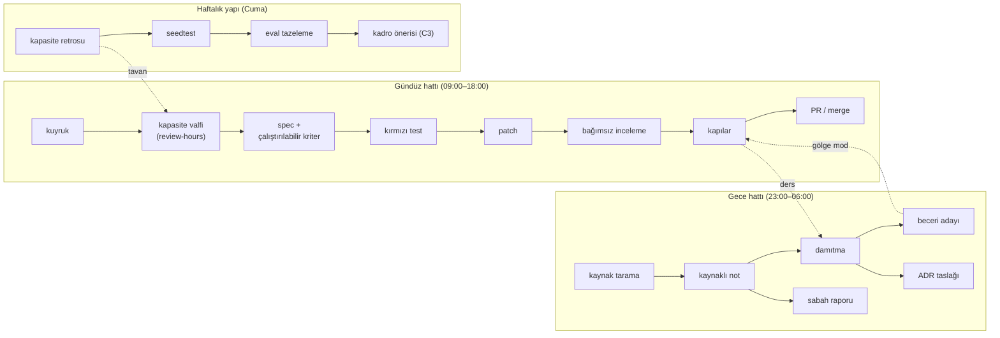

# KOVAN v2 — Kuracağımız Sistem

**Tarih:** 22 Ekim 2026 · **Sürüm:** v2
**Statü:** Bu dosya, `PRD.md` ve `MIMARI.md` ile çeliştiğinde **bu dosya geçerlidir**. v1 konsepti araştırmayla sınandı; bu, sınavdan çıkan sistem.

---

## 0. Tek cümle

> KOVAN, **kabul kapasitesine göre ayarlanmış**, kanıt zorunlu bir yazılım üretim hattıdır: gece araştırır ve damıtır, gündüz üretir, her değişiklik bağımsız kapılardan geçer, her karar hash-zincirli deftere yazılır.

Fabrika bir ajan sürüsü değil. **Bir vana + altı kapı + bir defter.**

---

## 1. v1'den v2'ye: ne değişti

| Alan | v1 (konsept) | v2 (araştırma sonrası) | Gerekçe |
|---|---|---|---|
| Kadro | 14 ajan + 2 insan | **6 ajan rolü + 1 insan** | İnceleme kapasitesi 14 rolü taşımıyor; rol sayısı kapasite değil |
| Döngü | 4 halka | **3 hat** (gündüz, gece, haftalık) | H3/H4 aynı haftalık ritmin parçası |
| Kapı | 8 kapı | **6 kapı + 1 maliyet uyarısı** | Aynı hatayı iki kapı yakalıyorsa bu kapsam değil maliyet |
| Eksen | Token bütçesi | **İnceleme-saati bütçesi** | Darboğaz token değil, kabul |
| Öğrenme | "Kendi kendine öğrenen" | **İskelet + beceri + kapı evrimi** | DGM/SICA ağırlık değiştirmiyor |
| Spec | Zorunlu artefakt | **Kapı tartışması**: artefakt kalır, kapı koşullu | Kiro/Spec Kit/GSD birincil dokümanları |
| Eval | Benchmark + judge | **Dondurulmuş kendi seti + tohumlanmış hata + κ** | Verified emekli; ham uyum κ'yı şişiriyor |
| Gece | 7 saat üretim | **Yalnızca artefakt; C2 kapalı; sabah kapasitesinin %50'si** | Gece üretimi WIP'i şişiriyor |

---

## 2. Sistemin üç hatı



**Kural:** Gece hattı ürün kodu üretmez (C2 kapalı). Gece üretimi, ertesi sabahki inceleme kapasitesinin **%50'sini** aşamaz. Aşarsa hat durur, rapor yazar.

---

## 3. Altı bileşen

| # | Bileşen | Dosya | Sorumluluk | Durum |
|---|---|---|---|---|
| 0 | **CLI** | `loop/kovan.py` | plan / run / verify / status; uçtan uca koşu | **Çalışıyor**, 6 test |
| 1 | **Kapasite valfi + kuyruk** | `loop/kapasite.py` + `kovan.py --tamamlanan` | LOC→saat, M/M/1, Little yasası, iş kabulü; **tamamlananlar birikir, kuyruk ilerler** (bloklananlar kayda girmez) | **Çalışıyor**, 18+3 test |
| 2 | **Hat koşucusu** | `loop/runner.py` | Görev döngüsü, kapı sırası, bütçe, devre kesici | **Çalışıyor**, 23 test |
| 2b | **Model adapter** | `loop/adapter_http.py` | OpenAI-uyumlu çağrı; sinyal ÜRETMEZ, yalnızca diff; **egress kaydı** (JSONL) | **Çalışıyor**, 5 test |
| 2c | **Doğrulama** | `loop/dogrula.py` | diff'i gerçek git deposuna uygular, gerçek test koşar, `tests` sinyali üretir; `--geri-al` ile depo başa döner | **Çalışıyor**, 7 test |
| 2c2 | **Uyum** | `loop/uyum.py` + `uyum-izinli.yaml` | import çıkarımı, izin listesi, bağımlılık dosyası tespiti, kopya şüphesi, yinelenen fonksiyon, **kopya blok (6 varyant sağlamlık testli)** → `provenance` sinyali | **Çalışıyor**, 14 test |
| 2h | **SBOM tohumu** | `loop/sbom.py` | Depoyu `ast` ile tarar; SPDX 2.3 JSON; **kök paket + supplier alanı (NTIA)**; sürümler lock dosyasından (`packages_distributions` ile modül→dağıtım çözümü) | **Çalışıyor**, 8 test |
| 2d | **Canlı profil** | `loop/gates-canli.yaml` | S2/S3: eval **bloklayıcı** (90 vaka), review koşullu bloklayıcı | Devrede |
| 2e | **Eval koşucusu** | `loop/eval_kos.py` + `eval_set/sicaklik-v1.jsonl` | 90 vakalık dondurulmuş seti diff'li depoda koşar, skor üretir | **Çalışıyor**, 4 test |
| 2f | **İncelemeci** | `loop/incelemeci.py` | İkinci model uç noktası; onay/ret + gerekce (gerekçesiz onay geçersiz) | **Çalışıyor**, 4 test |
| 3 | **Kapılar** | `loop/gates.yaml`, `loop/seedtest.py` | 6 kapı + tohumlanmış hata ile kapsam ölçümü | **Çalışıyor**, 9 test |
| 4 | **Defter** | `loop/ledger.jsonl` | Hash-zincirli karar kaydı, tahrif tespiti | **Çalışıyor** |
| 5 | **Bellek** | `loop/beceri.py` + `skills/` + `lessons.jsonl` | Beceri yaşam döngüsü (proposed→active→stale) + kullanım sayacı + çürüme | **İlk beceri AKTİF** |
| 2j | **Mutasyon testi** | `loop/mutasyon.py` | AST mutasyonları geçici klonda koşar; eval+test öldürme skoru | **Çalışıyor**, 4 test (6/6 öldü) |
| 2k | **Operasyon simülasyonu** | `loop/simulasyon.py` | N günlük çalışmayı tek komutta koşar: kapasite+hatlar+gece+retro; kriz günü ve determinizm testli | **Çalışıyor**, 5 test |
| 2l | **Konsol UTF-8** | `loop/konsol.py` | cp1252 tuzakına karşı stdout/stderr UTF-8 + replace | **Çalışıyor**, 3 test |
| 6 | **Rapor** | `reports/sabah-*.md`, `reports/kapasite-*.md` | Sabah raporu + kapasite raporu | Kısmi (`demo.py`) |
| 7 | **Gece hattı** | `loop/vardiya.py` + `loop/kaynak-kuyrugu.yaml` | Tarama (**kaynak rotasyonu: okunanlar atlanır**) → damıtma (idempotent) → kırmızı takım → ADR taslağı → sabah raporu; C2 kapalı | **Çalışıyor**, 11 test |
| 8 | **Zamanlayıcı** | `loop/gece-kos.ps1` + `gorev-kur.ps1` / `gorev-sil.ps1` | Her gece 23:00 yerel python (kuru mod, sıfır token) | **Kurulu** (KOVAN-Gece; ilk gerçek gece 04.11) |
| 10 | **S1 tatbikatı** | `loop/tatbikat.py` | Runbook'un **5 adımını** koşulur denetler (koşu, defter, STOP, **kaos/resume**, geri alma) — **Cuma görevi KOVAN-Hafta kurulu** | **Çalışıyor**, 3 test |
| 13 | **Haftalık retro** | `loop/retro.py` | GPK vekili + kapı trendi + mekanik checkler (koşulabilir komutlar); **log bütünlüğü taraması** (`--log-saglik`, UTF-8/UTF-16 BOM algılı) | **Çalışıyor**, 11 test |
| 9 | **Durum panosu** | `kovan.py durum` | Tüm koşuların çapraz metrikleri; haftalık retrospektifin verisi | **Çalışıyor**, 3 test |
| 11 | **Yapılandırma** | `loop/kullanici.yaml` | Kullanıcı varsayılanları (saat, repo, model…); CLI ezer | **Çalışıyor**, 3 test |
| 12 | **Kurulum** | `fabrika/pyproject.toml` | `pip install -e fabrika` → `kovan/vardiya/tatbikat/beceri` komutları | **Kanıtlandı** (entry point repo kökünden) |
| 13 | **Eval seti şablonu** | `loop/eval_set/SABLON.md` | Public kullanıcı için kendi dondurulmuş setini kurma kuralları | Yayında |
| 12 | **Kurulum** | `fabrika/pyproject.toml` | `pip install -e fabrika` → `kovan/vardiya/tatbikat/beceri` komutları | **Kanıtlandı** (entry point repo kökünden) |

**Toplam:** 162 test geçiyor (23 + 18 + 9 + 13 + 5 + 8 + 4 + 4 + 11 + 3 + 18 + 8 + 7 + 5 + 3 + 11 + 4 + 5 + 3).

---

## 4. Kapasite: sistemin kalbi

### 4.1 Formül

```
İnceleme eforu (saat) = LOC / 500 + 0,25
Kapasite (saat/gün)   = inceleyici × odaklı saat
Kuyruk süresi (M/M/1) = ρ / (μ − λ) × 24      ρ = λ/μ
WIP limiti (Little)   = hedef cycle time × günlük PR
```

### 4.2 Gerçek sayılarla

Tek kişi, günde **3 saat** odaklı inceleme:

| PR boyutu | Efor | Günlük PR tavanı |
|---|---|---|
| 150 LOC | 0,55 saat | ~5,4 |
| 400 LOC | 1,05 saat | ~2,9 |
| 800 LOC | 1,85 saat | ~1,6 |

Kuyruk (μ=10 PR/gün):

| λ (PR/gün) | ρ | Kuyruk süresi |
|---|---|---|
| 6,25 | 0,625 | **4,0 saat** (Google <4 saat) |
| 8,0 | 0,80 | 9,6 saat |
| 8,9 | 0,89 | **19 saat** (Faros +%441) |
| 9,5 | 0,95 | 45,6 saat |

**Okuma:** %95 doluluk "biraz yavaş" değil, **iki günlük kuyruk**. Sistem %85'in üstünde kısılmalı.

### 4.3 Örnek kabul (bugünkü çıktı)

6 görev, 3,0 saat kapasite:

```
kabul:     K-101, K-102, K-103, K-106, K-105
ertelenen: K-104 (600 LOC — tek başına 1,45 saat)
kullanım:  2,79 / 3,0 saat (%93)
```

**Ders:** 600+ LOC'luk PR ayrı slota alınmalı; küçük işlerle aynı kuyruğa konunca sürekli erteleniyor. v2 kuralı: **>400 LOC PR bölünür; bölünmüyorsa günün ilk slotu ona ayrılır.**

---

## 5. Kapılar: ne yakalıyor, ne yakalamıyor

`seedtest.py` 18 bilinen hatayı 6 kapı setine verir:

| Kapı seti | Yakalama | Kaçan |
|---|---|---|
| **Tam set (6 kapı)** | **%100** | 0 |
| Testsiz | %83,3 | test zayıflatma (2), test yok (1) |
| İncelemesiz | %94,4 | tasarım hatası (1) |
| Politikasız | %88,9 | sır okuma (2) |
| Sadece deterministik (lint+tip+test) | %50,0 | 9 |

**Tekrar kapsamı:** 7 hata iki kapı tarafından yakalanıyor (ör. `kapsam_disi` → policy + review; `davranis_hatasi` → tests + eval). Bu kapsam değil, **maliyet**. v2 kuralı: her hata sınıfı **tek** kapıya ait.

### Nihai kapı seti

| # | Kapı | Yakaladığı sınıf | Tip |
|---|---|---|---|
| 1 | `policy` | sır okuma, kapsam dışı dosya, lisans | deterministik |
| 2 | `types` (+lint) | tip hatası, biçim | deterministik |
| 3 | `tests` | test zayıflatma/silme, davranış hatası, test yok | deterministik |
| 4 | `review` | tasarım hatası, kapsam dışı niyet | yargı (bağımsız bağlam) |
| 5 | `eval` | regresyon, sınır davranışı | istatistiksel (dondurulmuş set + κ) |
| 6 | `provenance` | lisans, kopya kod | deterministik |

`cost` bloklamaz; %80'de model kademesini düşürür.

---

## 6. Bir gün nasıl işliyor

| Saat | Ne | Kim | Çıktı |
|---|---|---|---|
| 07:00 | Sabah raporu okunur; dünün dersleri | insan | 3 karar |
| 09:00 | Kuyruk + kapasite valfi: bugün kaç iş | operatör | kabul listesi |
| 09:30 | Spec + çalıştırılabilir kabul kriteri | spec ajanı | `specs/K-xxx.md` |
| 10:00 | Kırmızı test (kod yok) | test ajanı | `tests/` |
| 11:00 | Patch | kodlayıcı | diff |
| 13:00 | Bağımsız inceleme (gerekçeli) | incelemeci | onay/ret |
| 14:00 | Kapılar | koşucu | karar + defter |
| 15:00 | PR / merge | insan (C2) | merge |
| 16:00 | Ders + beceri adayı | damıtıcı | `lessons.jsonl` + `beceri-adaylari/` |
| 23:00 | Gece hattı: araştırma + damıtma | araştırmacı | not + aday + rapor |

**Gece tavanı:** Sabah 3 saat inceleme → gece en fazla 1,5 saatlik iş (≈1–2 küçük artefakt). Fazlası ertesi gün kuyruğa yığılır.

---

## 7. 90 gün: ne inşa ediyoruz

| Sprint | Hafta | İş | Çıkış kriteri |
|---|---|---|---|
| **S1 Kapasite** | 1–2 | `kapasite.py` + kuyruk + kapasite raporu; gerçek backlog | Günlük kabul listesi üretiliyor; 18 test |
| **S2 Hat** | 3–4 | Gerçek adapter (tek model), tek repo, 20 görev; eval v1 (≥50 vaka) | **Araç hazır:** adapter + doğrulama + canlı profil; gerçek anahtar ve 20 görev bekleniyor |
| **S3 Gece** | 5–6 | Gece hattı: ajanda, kaynak allowlist, damıtma, sabah raporu — **1 gerçek gece koşusu tamam (23:00, LastTaskResult 0)** | 5 gece üst üste rapor; ≥3 kaynaklı not/gece |
| **S4 Sertleştirme** | 7–8 | `seedtest` entegrasyonu, kanarya, geri alma, SBOM | **SBOM + kopya tespiti + kanarya + geri-al CLI hazır**; 2 hafta kesintisiz koşu bekliyor |

**Bugün hazır:** S1'in yarısı (kapasite + seedtest + hat koşucusu). Sıradaki tek iş: **gerçek backlog'u `backlog.yaml`'a dökmek ve günlük inceleme saatini ölçmek.**

---

## 8. Neyi inşa etmiyoruz

- **Çok-ajan sürüsü.** Kanıt yok; çakışma `C(n,2)` ile büyüyor. Tek yazıcı kuralı.
- **Kendi model eğitimi.** Ağırlık öğrenmesi kapsam dışı; C3.
- **Benchmark optimizasyonu.** Verified emekli; kendi setimiz + seedtest.
- **Otomatik deploy.** C3; insan kapısı.
- **14 rollük org.** 6 rol yeter; fazlası inceleme kuyruğu.
- **Vektör veritabanı.** 10k kayda kadar `rg` + SQLite indeks.
- **Web UI.** CLI + markdown; rapor dosyada.

---

## 9. Metrikler (90 gün)

| Metrik | Tanım | Hedef | Bugün |
|---|---|---|---|
| **Kapasite kullanımı** | kabul edilen / kapasite | %70–85 | Ölçülüyor (örnek %93) |
| **GPK** | İlk turda kapı geçme | ≥ %50 | Yok |
| **DSP** | Merge sonrası insan düzeltme satırı / PR | ≤ 25 | Yok |
| **Review-hours/PR** | İnceleme saati / PR | ≤ 1,0 | Hesaplanıyor |
| **KKA** | Kaçan regresyon / 100 PR | ≤ 1 | Yok |
| **ÖVD** | Kullanılan beceri / önerilen | ≥ %30 | **Ölçülebilir** (kullanim.jsonl) |

İlk üç ay için tek gerçek hedef: **GPK ve review-hours'u ölçmek.** Diğerleri ondan sonra.

---

## 10. Bugün çalıştırılabilir kanıt

```powershell
cd fabrika\loop

python kovan.py plan          # kapasiteye göre kabul listesi
python kovan.py run --run-id ornek-01   # uçtan uca koşu + rapor
python kovan.py verify --run runs\ornek-01

python vardiya.py run        # gece hattı: kaynak → damıtma → kırılma → ADR → sabah raporu
python sbom.py --repo ornek-repo    # SPDX 2.3 SBOM (stdlib/yerel/üçüncü taraf ayrımı)
python mutasyon.py --maks 6      # kapı öldürme skoru (6/6 öldü)
python retro.py                  # haftalık retro: GPK vekili + mekanik checkler
python tatbikat.py               # S1 runbook tatbikatı (5 adım PASS/FAIL)
python kovan.py durum        # tüm koşuların çapraz metrikleri
python gorev-kur.ps1         # gece görevini kur (23:00, yerel, sıfır token) — sil: gorev-sil.ps1

# eval v1 (dondurulmuş 90 vaka), kırık diff ile:
python eval_kos.py --repo ornek-repo --set eval_set\sicaklik-v1.jsonl --diff-dosya yama-kirik.diff

# canli mod (anahtar + hedef repo gerekir):
python kovan.py run --adapter http --base-url https://api.openai.com/v1 \
    --model gpt-4o-mini --anahtar-dosya .anahtar --repo ..\ornek-repo \
    --test-komut "python -m unittest discover -s tests -t ."

python kapasite.py            # 3.0 saat -> günde ~2.9 PR (400 LOC)
python seedtest.py            # tam set %100, testsiz %83.3
python tests\test_kapasite.py # 18 test
python tests\test_seedtest.py # 9 test
python tests\test_runner.py   # 22 test
python tests\test_kovan_cli.py # 6 test
```

66 test; hiçbiri zorunlu olarak model çağırmıyor. Sistemin iskeleti, modelden bağımsız olarak doğrulanmış durumda.

**Gece hattı notu:** `vardiya.py` üç sabit üretir: kaynaklı not (yerel kaynaklardan;
URL'ler canlı modda açılır), tekrar eden dersten beceri adayı (seen ≥ 2),
ve kapı kapsamı kırılma raporu (canlı profilin kaçırdığı türler). C2 gece kapalıdır;
çıktı yalnızca artefakt. Model bağlandığında aynı hat adapter'a geçer,
dosya sözleşmesi değişmez.

**Canlı mod notu:** `--adapter http` ile diff gerçek modelden gelir; `tests` sinyali
`dogrula.py` üzerinden **gerçek test koşumundan** üretilir — model sinyal söylemez.
Erişilemeyen sunucu/anahtar hatası fail-closed'dır: iş bloklanır, ders yazılır,
3 ardışık hatada devre kesici durur. review/eval kapıları canlı profilde geçici
olarak uyarıcıdır (gates-canli.yaml, tarihli gerekçe); S3'te bloklayıcı olur.

---

## 11. Senden gereken tek sayı

Sistemin tavanını belirleyen tek değişken: **günde kaç saat kesintisiz kod inceleyebiliyorsun?**

- 1 saat → günde ~1–2 PR; gece hattı ~0,5 saat.
- 3 saat → günde ~3–5 PR; gece hattı ~1,5 saat.
- 6 saat → günde ~6–10 PR; gece hattı ~3 saat (sürdürülemez risk).

Bu sayı girilince `kapasite.py` bütün kabul kararlarını üretir; geri kalan sistem ona göre ayarlanır.

---

## 12. v1 dosyalarıyla ilişki

| v1 dosyası | v2'de durumu |
|---|---|
| `PRD.md` | Gereksinimler geçerli; §9 metrikleri `review-hours` ile güncellenecek |
| `MIMARI.md` | Bileşenler geçerli; 4 halka → 3 hat |
| `ORGANIZASYON.md` | 14 rol → 6 rol (v2 §1) |
| `OGRENME.md` | Gece ajandası geçerli; "kendini geliştirme" tanımı daraltıldı |
| `KALITE.md` | Kapılar geçerli; seedtest + κ eklenmeli |
| `YONETISIM.md` | Geçerli; kimlik/izolasyon/geri alma önceliklendi |
| `ADR.md` | F01–F12 geçerli; F04/F06/F08 revizyon notu alacak |
| `EVIDENCE-UPDATE.md` | Bu dosyanın kısa versiyonu |

**Kural:** v2, v1'i silmez; **düzeltir**. Çelişki varsa v2 kazanır, ama v1'in gerekçeleri kaybolmaz.
| 15 | **Kuyruk üretici** | `loop/kuyruk_uret.py` | Kanıtlı iş önerileri: tekrar eden ders, kırılma senaryosu, doluluk → backlog-onerileri.yaml (insan onayı bekler) | **Çalışıyor**, 5 test |
