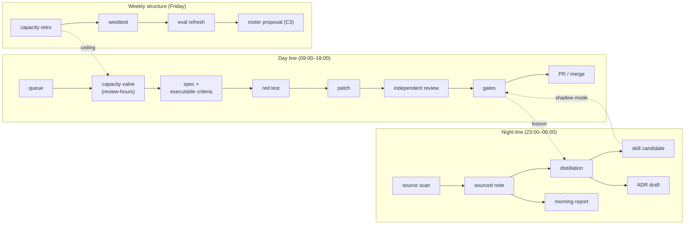

# KOVAN v2 — The System We Are Building

**Date:** October 22, 2026 · **Version:** v2
**Status:** When this file conflicts with `PRD.md` or `ARCHITECTURE.md`, **this file wins**. The v1 concept was tested against research; this is the system that survived the test.

---

## 0. One sentence

> KOVAN is a **capacity-bounded**, evidence-mandatory software production line: it researches and distills at night, produces by day, pushes every change through independent gates, and writes every decision to a hash-chained ledger.

The factory is not an agent swarm. **It is one valve + six gates + one ledger.**

---

## 1. v1 → v2: what changed

| Area | v1 (concept) | v2 (post-research) | Rationale |
|---|---|---|---|
| Roster | 14 agents + 2 humans | **6 agent roles + 1 human** | Review capacity cannot carry 14 roles; role count is not capacity |
| Loops | 4 rings | **3 lines** (day, night, weekly) | R3/R4 are part of the same weekly rhythm |
| Gates | 8 gates | **6 gates + 1 cost warning** | If two gates catch the same error, that is not coverage — it is cost |
| Axis | Token budget | **Review-hours budget** | The bottleneck is not tokens; it is acceptance |
| Learning | "Self-learning" | **Skeleton + skill + gate evolution** | DGM/SICA does not touch weights |
| Spec | Mandatory artifact | **Gate debate**: artifact stays, gate is conditional | Kiro/Spec Kit/GSD treat specs as primary documents |
| Eval | Benchmark + judge | **Own frozen set + seeded faults + κ** | Verified is retired; raw agreement inflates κ |
| Night | 7 hours of production | **Artifacts only; C2 closed; ≤50% of next morning's review capacity** | Night production inflates WIP |

---

## 2. The system's three lines



**Rule:** The night line produces no product code (C2 closed). Night
production cannot exceed **50%** of the next morning's review capacity. If it
would, the line stops and writes a report.

---

## 3. The components

| # | Component | File | Responsibility | Status |
|---|---|---|---|---|
| 0 | **CLI** | `loop/kovan.py` | plan / run / verify / status; end-to-end run | **Running**, 13 tests |
| 1 | **Capacity valve + queue** | `loop/capacity.py` + `kovan.py --tamamlanan` | LOC→hours, M/M/1, Little's law, task acceptance; **completed tasks accumulate, the queue progresses** (blocked ones are never recorded) | **Running**, 18+3 tests |
| 2 | **Line runner** | `loop/runner.py` | Task loop, gate order, budget, circuit breaker | **Running**, 23 tests |
| 2b | **Model adapter** | `loop/adapter_http.py` | OpenAI-compatible call; produces NO signals, only diffs; **egress log** (JSONL) | **Running**, 5 tests |
| 2c | **Verification** | `loop/verify.py` | Applies the diff to a real git repo, runs real tests, produces the `tests` signal; `--geri-al` resets the repo | **Running**, 8 tests |
| 2c2 | **Compliance** | `loop/compliance.py` + `compliance-allowlist.yaml` | import inference, allowlist, dependency-file detection, copy suspicion, duplicate functions, **duplicate block (structural signature, 6-variant robustness-tested)** → `provenance` signal | **Running**, 18 tests |
| 2h | **SBOM seed** | `loop/sbom.py` | Scans the repo with `ast`; SPDX 2.3 JSON; **root package + supplier field (NTIA)**; versions from lock files (module→distribution via `packages_distributions`) | **Running**, 8 tests |
| 2d | **Live profile** | `loop/gates-live.yaml` | S2/S3: eval **blocking** (90 cases), review conditionally blocking | Active |
| 2e | **Eval runner** | `loop/eval_run.py` + `eval_set/sicaklik-v1.jsonl` | Runs the frozen 90-case set on the diffed repo, produces a score | **Running**, 4 tests |
| 2f | **Reviewer** | `loop/incelemeci.py` | Second model endpoint; accept/reject + rationale (approval without rationale is invalid) | **Running**, 4 tests |
| 3 | **Gates** | `loop/gates.yaml`, `loop/seedtest.py` | 6 gates + coverage measurement with seeded faults | **Running**, 9 tests |
| 4 | **Ledger** | `loop/ledger.jsonl` | Hash-chained decision record, tamper detection | **Running** |
| 5 | **Memory** | `loop/beceri.py` + `skills/` + `lessons.jsonl` | Skill lifecycle (proposed→active→stale) + usage counter + decay | **First skill ACTIVE** |
| 2j | **Mutation testing** | `loop/mutasyon.py` | Runs AST mutations in a temp clone; eval+test kill score | **Running**, 4 tests (6/6 killed) |
| 2k | **Operations simulation** | `loop/simulasyon.py` | Runs an N-day operation in one command: capacity+lines+night+retro; crisis day and determinism tested | **Running**, 5 tests |
| 2l | **Console UTF-8** | `loop/console.py` | stdout/stderr UTF-8 + replace against the cp1252 trap | **Running**, 3 tests |
| 6 | **Reports** | `reports/sabah-*.md`, `reports/kapasite-*.md` | Morning report + capacity report | Partial (`demo.py`) |
| 7 | **Night line** | `loop/vardiya.py` + `loop/source-queue.yaml` | Scan (**source rotation: read ones are skipped**) → distillation (idempotent) → red team → ADR draft → morning report; C2 closed | **Running**, 11 tests |
| 8 | **Scheduler** | `loop/night-run.ps1` + `task-register.ps1` / `task-remove.ps1` | Nightly 23:00 local python (dry mode, zero tokens) | **Installed** (KOVAN-Night; first real night Nov 4) |
| 10 | **S1 drill** | `loop/tatbikat.py` | Executes and audits the runbook's **5 steps** (run, ledger, STOP, **chaos/resume**, rollback) — **Friday task installed as KOVAN-Week** | **Running**, 3 tests |
| 13 | **Weekly retro** | `loop/retro.py` | GPK proxy + gate trend + mechanical checks (runnable commands); **log integrity scan** (`--log-saglik`, UTF-8/UTF-16 BOM aware) | **Running**, 11 tests |
| 9 | **Status board** | `kovan.py durum` | Cross-run metrics for all runs; data source for the weekly retro | **Running**, 3 tests |
| 11 | **Configuration** | `loop/user.yaml` | User defaults (hours, repo, model…); CLI overrides | **Running**, 3 tests |
| 12 | **Packaging** | `fabrika/pyproject.toml` | `pip install -e fabrika` → `kovan/vardiya/tatbikat/beceri` commands | **Proven** (entry points from repo root) |
| 13 | **Eval set template** | `loop/eval_set/TEMPLATE.md` | Rules for public users to build their own frozen set | Published |
| 15 | **Queue producer** | `loop/queue_build.py` | Evidence-based task proposals: repeated lesson, breakage scenario, saturation → backlog-proposals (awaits human approval) | **Running**, 5 tests |

**Total:** 167 tests passing (23 + 18 + 9 + 13 + 5 + 8 + 4 + 4 + 11 + 3 + 18 + 8 + 7 + 5 + 3 + 11 + 4 + 5 + 3 + 5).

---

## 4. Capacity: the heart of the system

### 4.1 Formula

```
Review effort (hours)     = LOC / 500 + 0.25
Capacity (hours/day)      = reviewers × focused hours
Queue time (M/M/1)        = ρ / (μ − λ) × 24      ρ = λ/μ
WIP limit (Little's law)  = target cycle time × daily PRs
```

### 4.2 With real numbers

One person, **3 hours** of focused review per day:

| PR size | Effort | Daily PR ceiling |
|---|---|---|
| 150 LOC | 0.55 h | ~5.4 |
| 400 LOC | 1.05 h | ~2.9 |
| 800 LOC | 1.85 h | ~1.6 |

Queue (μ=10 PR/day):

| λ (PR/day) | ρ | Queue time |
|---|---|---|
| 6.25 | 0.625 | **4.0 h** (Google <4 h) |
| 8.0 | 0.80 | 9.6 h |
| 8.9 | 0.89 | **19 h** (Faros +441%) |
| 9.5 | 0.95 | 45.6 h |

**Reading:** 95% utilization is not "a bit slow" — it is a **two-day queue**.
The system must throttle above 85%.

### 4.3 Sample acceptance (today's output)

6 tasks, 3.0-hour capacity:

```
accepted:  K-101, K-102, K-103, K-106, K-105
deferred:  K-104 (600 LOC — 1.45 h on its own)
usage:     2.79 / 3.0 hours (93%)
```

**Lesson:** a 600+ LOC PR belongs in its own slot; in the same queue as small
tasks it keeps getting deferred. v2 rule: **a >400 LOC PR is split; if it
cannot be split, the first slot of the day is reserved for it.**

---

## 5. Gates: what they catch, what they miss

`seedtest.py` feeds 18 known faults into the 6-gate set:

| Gate set | Catch rate | Missed |
|---|---|---|
| **Full set (6 gates)** | **100%** | 0 |
| Without tests | 83.3% | test weakening (2), missing test (1) |
| Without review | 94.4% | design error (1) |
| Without policy | 88.9% | secret reading (2) |
| Deterministic only (lint+types+tests) | 50.0% | 9 |

**Overlap:** 7 faults are caught by two gates (e.g. `out_of_scope` → policy +
review; `behavior_bug` → tests + eval). That is not coverage — it is **cost**.
v2 rule: every fault class belongs to **one** gate.

### Final gate set

| # | Gate | Fault classes caught | Type |
|---|---|---|---|
| 1 | `policy` | secret reading, out-of-scope file, license | deterministic |
| 2 | `types` (+lint) | type errors, formatting | deterministic |
| 3 | `tests` | test weakening/removal, behavior bug, missing test | deterministic |
| 4 | `review` | design error, out-of-scope intent | judgment (independent context) |
| 5 | `eval` | regressions, boundary behavior | statistical (frozen set + κ) |
| 6 | `provenance` | license, duplicated code | deterministic |

`cost` does not block; at 80% it downgrades the model tier.

---

## 6. How a day flows

| Time | What | Who | Output |
|---|---|---|---|
| 07:00 | Morning report read; yesterday's lessons | human | 3 decisions |
| 09:00 | Queue + capacity valve: how many tasks today | operator | acceptance list |
| 09:30 | Spec + executable acceptance criteria | spec agent | `specs/K-xxx.md` |
| 10:00 | Red test (no code) | test agent | `tests/` |
| 11:00 | Patch | coder | diff |
| 13:00 | Independent review (with rationale) | reviewer | accept/reject |
| 14:00 | Gates | runner | decision + ledger |
| 15:00 | PR / merge | human (C2) | merge |
| 16:00 | Lesson + skill candidate | distiller | `lessons.jsonl` + `beceri-adaylari/` |
| 23:00 | Night line: research + distillation | researcher | note + candidate + report |

**Night ceiling:** 3 hours of morning review → at most 1.5 hours of night
work (≈1–2 small artifacts). The rest piles into the next day's queue.

---

## 7. 90 days: what we are building

| Sprint | Week | Work | Exit criteria |
|---|---|---|---|
| **S1 Capacity** | 1–2 | `capacity.py` + queue + capacity report; real backlog | Daily acceptance list produced; 18 tests |
| **S2 Line** | 3–4 | Real adapter (single model), single repo, 20 tasks; eval v1 (≥50 cases) | **Tool ready:** adapter + verification + live profile; waiting for a real key and 20 tasks |
| **S3 Night** | 5–6 | Night line: agenda, source allowlist, distillation, morning report — **1 real night run done (23:00, LastTaskResult 0)** | 5 consecutive nights with reports; ≥3 sourced notes/night |
| **S4 Hardening** | 7–8 | `seedtest` integration, canary, rollback, SBOM | **SBOM + duplicate detection + canary + rollback CLI ready**; waiting for 2 uninterrupted weeks of runs |

**Ready today:** half of S1 (capacity + seedtest + line runner). The single
next step: **pour the real backlog into `backlog.yaml` and measure daily
review hours.**

---

## 8. What we are NOT building

- **A multi-agent swarm.** No evidence; conflicts grow as `C(n,2)`. Single-writer rule.
- **Training our own model.** Weight learning is out of scope; C3.
- **Benchmark optimization.** Verified is retired; our own set + seedtest.
- **Automatic deploy.** C3; human gate.
- **A 14-role org.** 6 roles suffice; more is a review queue.
- **A vector database.** Up to 10k records, `rg` + a SQLite index.
- **A web UI.** CLI + markdown; reports live in files.

---

## 9. Metrics (90 days)

| Metric | Definition | Target | Today |
|---|---|---|---|
| **Capacity utilization** | accepted / capacity | 70–85% | Measured (sample: 93%) |
| **GPK** (first-pass acceptance) | Gate pass on first round | ≥ 50% | None yet |
| **DSP** (human-fix lines) | Human correction lines after merge / PR | ≤ 25 | None yet |
| **Review-hours/PR** | Review hours / PR | ≤ 1.0 | Being computed |
| **KKA** (escaped regressions) | Escaped regressions / 100 PRs | ≤ 1 | None yet |
| **ÖVD** (skill usage) | Skills used / skills proposed | ≥ 30% | **Measurable** (kullanim.jsonl) |

For the first three months, the only real target: **measure GPK and
review-hours.** The rest comes after.

---

## 10. Runnable evidence today

```powershell
cd fabrika\loop

python kovan.py plan          # acceptance list under capacity
python kovan.py run --run-id ornek-01   # end-to-end run + report
python kovan.py verify --run runs\ornek-01

python vardiya.py run        # night line: source → distill → breakage → ADR → morning report
python sbom.py --repo ornek-repo    # SPDX 2.3 SBOM (stdlib/local/third-party split)
python mutasyon.py --maks 6      # gate kill score (6/6 killed)
python retro.py                  # weekly retro: GPK proxy + mechanical checks
python tatbikat.py               # S1 runbook drill (5 steps PASS/FAIL)
python kovan.py durum        # cross-run metrics for all runs
powershell -File task-register.ps1  # install the night task (23:00, local, zero tokens) — remove: task-remove.ps1

# eval v1 (frozen 90 cases), with a broken diff:
python eval_run.py --repo ornek-repo --set eval_set\sicaklik-v1.jsonl --diff-dosya yama-kirik.diff

# live mode (needs a key + target repo):
python kovan.py run --adapter http --base-url https://api.openai.com/v1 \
    --model gpt-4o-mini --anahtar-dosya .anahtar --repo ..\ornek-repo \
    --test-komut "python -m unittest discover -s tests -t ."

python capacity.py            # 3.0 hours -> ~2.9 PRs/day (400 LOC)
python seedtest.py            # full set 100%, without tests 83.3%
python tests\test_capacity.py # 18 tests
python tests\test_seedtest.py # 9 tests
python tests\test_runner.py   # 23 tests
python tests\test_kovan_cli.py # 13 tests
```

167 tests; none of them mandatorily calls a model. The system's skeleton is
verified independently of the model.

**Night line note:** `vardiya.py` produces three artifacts: a sourced note
(from local sources; URLs open in live mode), a skill candidate from a
repeated lesson (seen ≥ 2), and a gate-coverage breakage report (types the
live profile misses). C2 is closed at night; the output is artifacts only.
When a model is connected, the same line switches to the adapter — the file
contract does not change.

**Live mode note:** with `--adapter http` the diff comes from a real model;
the `tests` signal is produced **from a real test run** via `verify.py` —
the model never declares a signal. An unreachable server/key is fail-closed:
the task blocks, a lesson is written, and after 3 consecutive failures the
circuit breaker stops. review/eval gates are temporarily warning-only in the
live profile (gates-live.yaml, dated rationale); they become blocking in S3.

---

## 11. The one number we need from you

The single variable that sets the system's ceiling: **how many hours of
uninterrupted code review can you do per day?**

- 1 hour → ~1–2 PRs/day; night line ~0.5 h.
- 3 hours → ~3–5 PRs/day; night line ~1.5 h.
- 6 hours → ~6–10 PRs/day; night line ~3 h (unsustainable risk).

Once this number is in, `capacity.py` produces every acceptance decision; the
rest of the system tunes itself around it.

---

## 12. Relationship to the v1 files

| v1 file | Status in v2 |
|---|---|
| `PRD.md` | Requirements valid; §9 metrics to be updated with `review-hours` |
| `ARCHITECTURE.md` | Components valid; 4 rings → 3 lines |
| `ORGANIZATION.md` | 14 roles → 6 roles (v2 §1) |
| `LEARNING.md` | Night agenda valid; "self-improvement" definition narrowed |
| `QUALITY.md` | Gates valid; seedtest + κ to be added |
| `GOVERNANCE.md` | Valid; identity/isolation/rollback prioritized |
| `ADR.md` | F01–F12 valid; F04/F06/F08 will get revision notes |
| `EVIDENCE-UPDATE.md` | The short version of this file |

**Rule:** v2 does not delete v1; it **corrects** it. On conflict v2 wins, but
v1's rationale is never lost.
